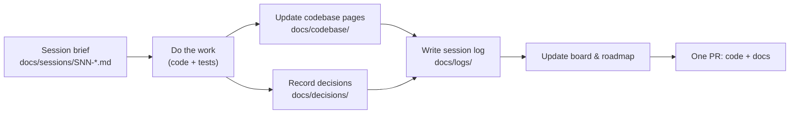

# Red Alert Multiplayer Port — Project Wiki

Welcome to the project wiki. It lives in the repository (`docs/`) so that documentation is
versioned and reviewed together with the code it describes. GitHub renders every page,
including the Mermaid diagrams.

## Start here

| Page | What it covers |
|------|----------------|
| [Vision & scope](vision.md) | What we are building, what we are not building, and what "done" means |
| [Roadmap (visual plan)](roadmap.md) | Phases, milestones and the session dependency graph |
| [Session board](sessions/README.md) | Every work session, its status, and which ones can run in parallel |
| [Codebase overview](codebase/overview.md) | Map of the original source tree and its dependencies |
| [Decisions (ADRs)](decisions/README.md) | Why things are the way they are |
| [Session logs](logs/README.md) | A dated record of what was actually done in each session |

## How work is organised

- A **session** is a focused unit of work that one agent (or person) can finish in one sitting
  and deliver as one pull request. Large sessions are split into sub-tasks that can run in parallel.
- Every session ends with a **session log**. Nothing is done until it is documented.
  The full rules are in [`CLAUDE.md`](../CLAUDE.md).

## Glossary

| Term | Meaning |
|------|---------|
| Lockstep | Networking model where every player runs the same simulation and only exchanges commands ("events"). Used by Red Alert (`CODE/QUEUE.CPP`). |
| Desync | Two players' simulations diverge; the game can no longer continue. |
| MIX file | Red Alert's asset archive format. Players supply these from their own copy of the game. |
| Watcom / TASM | The original 1990s C++ compiler and assembler. We are replacing both. |
| WOL | Westwood Online — the original (now dead) online service. Its client code is in `CODE/WOL_*.CPP`. |
| ADR | Architecture Decision Record — a short document explaining one decision. |
