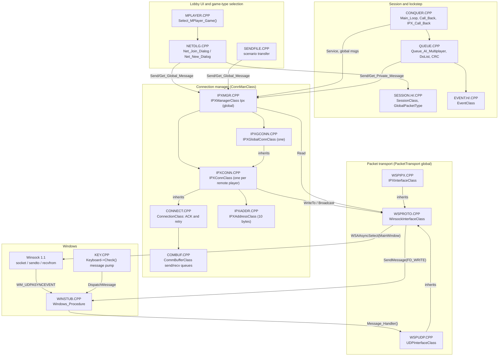
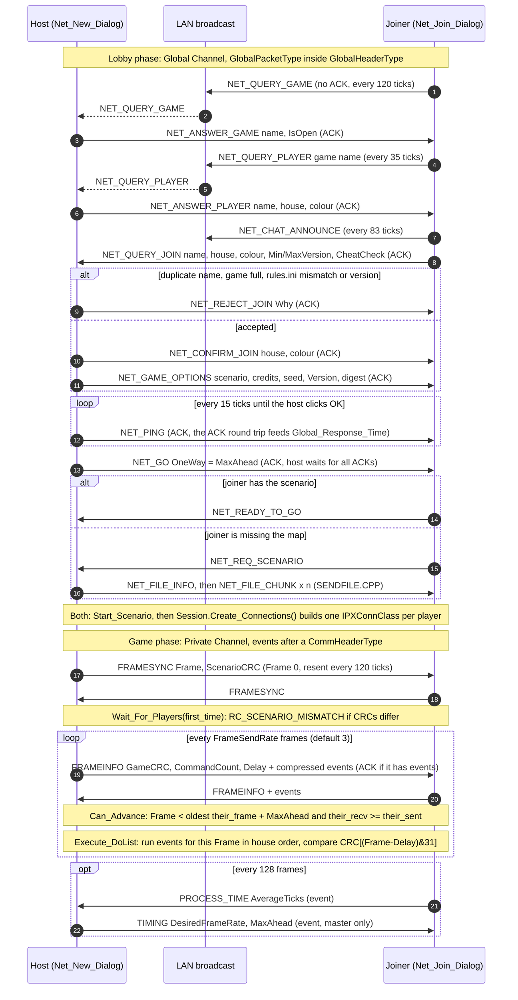

# Networking: how the original multiplayer stack works

Written in session S04 from reading the source; nothing here has been run yet. File references are
`FILE:line` in `CODE/` at commit `0ebf96c`. Anything not confirmed in the code is marked **unverified**.
The target LAN design built on top of this is in [`../design/lan-multiplayer.md`](../design/lan-multiplayer.md).

## Summary (read this first)

- **The LAN menu entry does not use UDP today.** `GAME_IPX` creates an `IPXInterfaceClass`, which is
  native IPX through Winsock (`INIT.CPP:1252-1256`). The UDP option is commented out right next to it
  (`INIT.CPP:1254-1268`). `UDPInterfaceClass` is only created for Westwood Online internet games
  (`INIT.CPP:1198-1204`). [`overview.md`](overview.md) said the opposite; that line is corrected by this page.
- **The whole connection layer is shared and transport-agnostic.** The classes are named "IPX"
  (`IPXManagerClass`, `IPXConnClass`, `IPXAddressClass`), but with `WINSOCK_IPX` defined (it always is
  in the Win32 build, `MAKEFILE:90`) they only talk to the abstract `PacketTransport`. UDP slots in
  underneath without changing them.
- **The UDP transport is incomplete for LAN.** It has no real broadcast: `Broadcast()` unicasts to a list
  of IPs typed into `IP.INI` (`WSPUDP.CPP:249-290`, `UDPADDR.CPP:112-130`). It never sets `SO_BROADCAST`.
  The port is a fixed global used both to bind and as the destination of every packet (`WSPUDP.CPP:170`,
  `WSPUDP.CPP:404`), and it drops every packet from a local IP address (`WSPUDP.CPP:358-360`). So
  **two instances on one machine cannot talk**, and LAN discovery would not work even if the menu used UDP.
- **Windows window messages drive the socket.** `WSAAsyncSelect(Socket, MainWindow, ...)`
  (`WSPROTO.CPP:190`) posts `WM_UDPASYNCEVENT`. `Windows_Procedure` forwards it to
  `UDPInterfaceClass::Message_Handler` (`WINSTUB.CPP:184-192`), which does the actual `recvfrom`/`sendto`.
  Sends happen via `SendMessage(MainWindow, ..., FD_WRITE)` (`WSPROTO.CPP:456`). Packets only move
  when something pumps messages: `Keyboard->Check()` → `PeekMessage`/`DispatchMessage` (`KEY.CPP:521-531`).
- **Lockstep is in `QUEUE.CPP`** and doesn't care about the transport: frame-stamped events, `MaxAhead`,
  `FrameSendRate` = 3, a per-frame game CRC compared 32 frames deep, host-driven frame-rate and
  `MaxAhead` re-negotiation every 128 frames.
- **Wire structs are byte-packed (`/zp1`) and also depend on Watcom's enum sizing.** No `/ei` flag is
  given, so enums take the smallest type that fits (**unverified** against a Watcom build, but the code
  relies on it, see [Packing](#struct-packing-and-why-it-matters)). With a modern compiler's 4-byte enums,
  `EventClass` grows from 20 to 32 bytes. With GCC's default bitfield layout, `GlobalPacketType.ScenarioInfo`
  also shifts. A Linux and a Windows build would not understand each other without explicit layout control.

## Layers

### 1. Lobby UI: `MPLAYER.CPP`, `NETDLG.CPP`, `SENDFILE.CPP`

- `Select_MPlayer_Game()` (`MPLAYER.CPP`) shows Skirmish / Modem / Network / Internet. The Network button
  (`TXT_NETWORK`, `MPLAYER.CPP:185`) is only shown when `Ipx.Is_IPX()` is true (`MPLAYER.CPP:142,194`),
  which just means `WSAStartup` succeeded (`IPXMGR.CPP:130-139`). The button returns `GAME_IPX`
  (`MPLAYER.CPP:417-418`). The visible label comes from the string table; whether it reads "IPX" or
  "Network" is **unverified** (no assets in the repo).
- `INIT.CPP:1247-1289`: for `GAME_IPX` it creates the transport, then `Init_Network()` → `Ipx.Init()`
  (`NETDLG.CPP:952-980`), then `Remote_Connect()` (`NETDLG.CPP:1246-1326`). That loops between
  `Net_Join_Dialog()` (`NETDLG.CPP:1383`, the browser/joiner side) and `Net_New_Dialog()`
  (`NETDLG.CPP:4035`, the host side).
- Discovery, join, options, chat and game start all happen in these two dialogs over the **Global
  Channel** (see [packets](#global-channel-lobby-packets-globalpackettype)).
- `Process_Global_Packet()` (`NETDLG.CPP:1079-1138`) is the "standard" responder for `NET_QUERY_GAME` and
  `NET_QUERY_PLAYER`, used by whichever dialog is open.
- `SENDFILE.CPP` sends a custom scenario from host to joiner (`NET_REQ_SCENARIO`, `NET_FILE_INFO`,
  `NET_FILE_CHUNK`) over the Global Channel.
- `Net_Fake_New_Dialog` / `Net_Fake_Join_Dialog` and `Server_Remote_Connect` / `Client_Remote_Connect`
  (`NETDLG.CPP:6136`, `6920`, `7731`, `7777`) belong to the old WChat-spawned internet path. They are
  only reachable from `INIT.CPP:1011-1166`, which is compiled out by `#ifndef WOLAPI_INTEGRATION`.
- During a game, `IPX_Call_Back()` (`CONQUER.CPP:1691`) services the manager and handles in-game Global
  Channel packets: `NET_SIGN_OFF` (destroys that connection) and `NET_MESSAGE` (chat). It only reads
  global messages when `Session.NetOpen` is false, so it doesn't steal the dialogs' packets.

### 2. Session: `SESSION.H/.CPP`

`SessionClass Session` holds the multiplayer state:
- the game type (`GameEnum`, `SESSION.H:120-129`) and `CommProtocol`;
- player and game lists (`Players`, `Games`, `Chat`, all `NodeNameType`, `SESSION.H:250-276`);
- `MaxAhead`, `FrameSendRate`, `DesiredFrameRate` (`SESSION.H:560-563`);
- the packet scratch areas `GPacket` and `MetaPacket[MAX_IPX_PACKET_SIZE]` (`SESSION.H:644`);
- record/playback (`Record`, `Play`, `RecordFile`).

Defaults are in `SessionClass::SessionClass` (`SESSION.CPP:150-200`): `MaxAhead = 5`, `FrameSendRate = 3`,
`CommProtocol = COMM_PROTOCOL_MULTI_E_COMP`, `MaxPlayers = 8`.

- `Create_Connections()` (`SESSION.CPP:331-357`) is called when the scenario starts (`INIT.CPP:1523`).
  It creates one private connection per remote player, using the address learned in the lobby. The
  connection ID is that player's `HousesType`.
- `Am_I_Master()` (`SESSION.CPP:487`): the master is the system that owns the first human house. Only
  the master sends `TIMING` events.
- Player settings (handle, colour, side) live in `REDALERT.INI [MultiPlayer]`
  (`SESSION.CPP:745-758`, `DEFINES.H:480`).

### 3. Connection manager: `IPXMGR`, `IPXGCONN`, `IPXCONN`, `CONNECT`, `COMBUF`, `IPXADDR`

**`IPXManagerClass Ipx`** is a global (`GLOBALS.CPP:651-657`) implementing the abstract
`ConnManClass` (`CONNMGR.H`). Its constructor arguments:

| Argument | Value | Meaning |
|---|---|---|
| Global max packet | `MAX(sizeof(GlobalPacketType), sizeof(RemoteFileTransferType))` = 198 (Watcom sizes) | Largest lobby payload |
| Private max packet | `((546 - 7) / sizeof(EventClass)) * sizeof(EventClass)` = 520 | Largest game payload (26 events). 546 = max IPX payload |
| Global queue | 160 entries | |
| Private queue | 32 entries per connection | |
| Socket | `VIRGIN_SOCKET` 0x8813 (`IPXMGR.H:134`) | IPX socket. Ignored by UDP |
| Product ID | `COMMAND_AND_CONQUER0` = 0xaa00 (`IPXGCONN.H:131`) | Also the private-channel magic number |

- The constructor calls `WSAStartup` during **static initialisation** to probe for Winsock, then shuts it
  down again (`IPXMGR.CPP:126-139`).
- `Init()` (`IPXMGR.CPP:294-380`) creates the Global Channel and, except for `GAME_INTERNET`, opens the
  socket and starts listening through `IPXConnClass::Start_Listening()` → `PacketTransport->Open_Socket()`
  and `Start_Listening()` (`IPXCONN.CPP:272-292`). Up to `CONNECT_MAX` = 7 private connections, so at
  most 8 players (`IPXMGR.H:140`).
- **`Service()`** (`IPXMGR.CPP:978-1294`) is the heart of the receive path:
  1. It drains `PacketTransport->Read()` and casts the 64-byte transport address to `IPXAddressClass`
     (`IPXMGR.CPP:996-1004`).
  2. It demultiplexes by the first 2 bytes. `GLOBAL_MAGICNUM` 0x1235 goes to the Global Channel.
     `ProductID` 0xaa00 goes to the private connection whose `Address` matches the sender
     (`IPXMGR.CPP:1007-1028`). Packets from unknown addresses are dropped, except for one
     `GAME_INTERNET` case (below).
  3. It calls `Service()` on every connection, which resends and checks timeouts. A connection that
     timed out sets `BadConnection` (`IPXMGR.CPP:1275-1292`).
- **NAT workaround (`GAME_INTERNET` only, `IPXMGR.CPP:1029-1068`)**: a `FRAMESYNC` from an unknown
  address carrying a known player ID re-points that player's connection to the new address. This is the
  only NAT handling in the code, and a useful pattern for internet play later.

**`ConnectionClass`** (`CONNECT.CPP`) implements reliability on top of datagrams:
- `Send_Packet` prefixes a `CommHeaderType` and queues the packet. With an ACK, the `PacketID` is a
  per-connection counter (`CONNECT.CPP:217-258`).
- `Receive_Packet`:
  - ACKs mark send entries as acknowledged;
  - `DATA_ACK` packets are de-duplicated with `LastSeqID` and a queue scan, and are always answered with
    an ACK;
  - `DATA_NOACK` packets are queued unless only one slot is left (`CONNECT.CPP:277-461`).
- `Get_Packet` delivers `DATA_ACK` packets **in order** (`LastReadID + 1`). `DATA_NOACK` packets go out
  as they come (`CONNECT.CPP:480-539`).
- `Service_Send_Queue` resends unacknowledged packets every `RetryDelta` ticks. It reports a bad
  connection when one packet has been retried for longer than `Timeout` ticks (`CONNECT.CPP:594-707`).
- Time is `TickCount`, which runs at 60 Hz (`CONNECT.CPP:774-807`).

**`IPXConnClass`** (`IPXCONN.CPP`) adds a destination `IPXAddressClass` and, under `WINSOCK_IPX`, sends
with `PacketTransport->WriteTo(buf, len, &Address)` (`IPXCONN.CPP:611-619`). Broadcasts go through
`PacketTransport->Broadcast()` (`IPXCONN.CPP:778-782`). Everything else in the file is the DOS
real-mode path or the old THIPX32 DLL path (`#ifndef WINSOCK_IPX`).

**`IPXGlobalConnClass`** (`IPXGCONN.CPP`) is the connectionless lobby channel:
- it adds a `ProductID` to the header and stores the sender/destination address as "extra" data in each
  queue entry;
- a `NULL` destination becomes a broadcast;
- it detects resends with the last 4 (address, ID) pairs (`IPXGCONN.CPP:119-322`);
- an ACK is only requested when the packet has a specific destination.

**`IPXAddressClass`** (`IPXADDR.H:101-102`) is 10 bytes: `NetworkNumber[4]` and `NodeAddress[6]`.
- For UDP the transport encodes an IPv4 address as net = `00 00 00 00`, node = `a b c d 00 00`. On send,
  `WSPUDP.CPP:405` reads the IP from bytes 4..7 of the address buffer. On receive,
  `WSPUDP.CPP:368-369` writes it there.
- `operator==` compares only the node when either network number is zero (`IPXADDR.CPP:325-361`).
  That means **node bytes 4..5 are compared but are always zero**, which is where a UDP port could live
  (used by the design).

**`CommBufferClass`** (`COMBUF.H/.CPP`) is the fixed-size send and receive queue with response-time
statistics. **`COMQUEUE`, `SEQCONN` and `NOSEQCON` are not in the makefile and are dead code**
(`CommQueueClass` is only used by `SEQCONN.CPP`).

### 4. Packet transport: `WSPROTO`, `WSPUDP`, `WSPIPX`, `_WSPROTO`, `UDPADDR`

`WinsockInterfaceClass *PacketTransport` (`_WSPROTO.CPP:40`) is the only object the connection layer
talks to. Its interface (`WSPROTO.H`):

| Method | Behaviour today |
|---|---|
| `Init()` | `WSAStartup(1.1)` (`WSPROTO.CPP:292-348`) |
| `Open_Socket(SOCKET)` | UDP: `socket(AF_INET, SOCK_DGRAM)`, `bind(INADDR_ANY:PlanetWestwoodPortNumber)`. It ignores its argument, collects local IPs with `gethostbyname(gethostname())`, sets linger off and 128 KB buffers (`WSPUDP.CPP:146-229`). IPX: `AF_IPX` socket bound to the card's net/node, `SO_BROADCAST`, packet type 4 (`WSPIPX.CPP:172-278`) |
| `Start_Listening()` | `WSAAsyncSelect(Socket, MainWindow, WM_UDPASYNCEVENT, FD_READ \| FD_WRITE)` (`WSPROTO.CPP:185-198`) |
| `Read(buf, len, addr, addrlen)` | Pumps window messages (`Keyboard->Check()`), then pops one packet from `InBuffers` (`WSPROTO.CPP:371-411`) |
| `WriteTo(buf, len, addr)` | Queues to `OutBuffers`, copies 10 address bytes, then `SendMessage(MainWindow, WM_..., FD_WRITE)` and pumps messages (`WSPROTO.CPP:432-462`) |
| `Broadcast(buf, len)` | UDP: one queued copy per entry in `BroadcastAddresses` (`WSPUDP.CPP:249-290`). **The list is empty unless `Set_Broadcast_Address()` was called** |
| `Message_Handler(...)` | `FD_READ`: one `recvfrom`. Packets whose source IP is a local address are dropped, otherwise queued to `InBuffers`. `FD_WRITE`: one `sendto` to `ip:PlanetWestwoodPortNumber`. **On `WSAEWOULDBLOCK` the packet is deleted anyway** (`WSPUDP.CPP:310-431`) |

- `WinsockBufferType` holds a 64-byte address and a 1024-byte payload (`WSPROTO.H:145-150`).
- `UDPADDR.CPP` has `Get_Broadcast_Addresses()`, a dialog that loads `IP.INI [IP_ADDRESSES] 1=..`, and
  feeds each entry to `Set_Broadcast_Address()`. Its only call site is commented out (`INIT.CPP:1260`).
- **This was an "IP list" LAN mode, not broadcast discovery.**

**Ports:**

| What | Value | Where |
|---|---|---|
| UDP port (bind **and** destination for every peer) | `PlanetWestwoodPortNumber = 1234` | `INTERNET.CPP:78`, used at `WSPUDP.CPP:170,404` |
| UDP port override | `C&CSPAWN.INI [Internet] Port=` via `Check_From_WChat` | `INTERNET.CPP:177-191`, compiled out under `WOLAPI_INTEGRATION` (`INTERNET.CPP:111`), so **effectively always 1234** in the shipped build |
| IPX socket | 0x8813 (`VIRGIN_SOCKET`) | `IPXMGR.H:134` |
| IPX socket override | `-SOCKET<n>` → 0x4000 + n | `INIT.CPP:1920-1928` |
| WOL/TCP (`TCPIP.CPP`) | `PlanetWestwoodPortNumber` | `TCPIP.CPP:459,628,813`, not on the LAN path |

### 5. Sockets and Windows

See [Windows-specific dependencies](#windows-specific-dependencies-on-the-lan-path).

## Sequence: host a LAN game → player joins → game starts → frames exchanged

All lobby traffic goes on the Global Channel. ACK-required packets are retried by `ConnectionClass`.
The host's lobby timing is `Set_Timing(30, -1, 600)`: retry every 0.5 s, give up after 10 s
(`NETDLG.CPP:1255`).

Step by step, with sources:

1. **Discovery.** `Send_Join_Queries()` (`NETDLG.CPP:3229-3331`) broadcasts:
   - `NET_QUERY_GAME` every 120 ticks;
   - `NET_QUERY_PLAYER` for the selected game every 35 ticks;
   - `NET_CHAT_ANNOUNCE` every 83 ticks.

   A host answers `NET_QUERY_GAME` with a unicast `NET_ANSWER_GAME` (`NETDLG.CPP:1093-1115`). The
   joiner adds or refreshes the game by **name** and stores the **sender address** (`NETDLG.CPP:3405-3420`).
   Every member of the game answers `NET_QUERY_PLAYER` (`NETDLG.CPP:1120-1134`). Joiners build
   `Session.Players` from those answers, keyed by sender address (`NETDLG.CPP:3524-3560`).
2. **Join.** `Request_To_Join()` sends `NET_QUERY_JOIN` to the game's address (`NETDLG.CPP:3075-3099`).
   The host (`NETDLG.CPP:5246-5444`) rejects with `REJECT_DUPLICATE_NAME`, `REJECT_GAME_FULL`,
   `REJECT_MISMATCH` (rules.ini ID), `REJECT_VERSION_TOO_OLD` or `REJECT_VERSION_TOO_NEW`. Otherwise it
   assigns a colour and replies `NET_CONFIRM_JOIN`. The reasons are listed at `NETDLG.CPP:182-190`.
3. **Options.** The host sends `NET_GAME_OPTIONS` to each player whenever options change
   (`NETDLG.CPP:4950-4996`). Joiners copy scenario, credits, seed, `Special`, game speed and version, and
   derive `CommProtocol` from it (`NETDLG.CPP:3701-3758`).
4. **Latency probe.** The host pings every joined player every 15 ticks (`NETDLG.CPP:5005-5013`). The
   Global Channel's ACK round-trip time feeds `Ipx.Global_Response_Time()`.
5. **Start.** The host computes `MaxAhead = max(roundup(GlobalResponseTime/8, FrameSendRate), 2*FrameSendRate)`
   (`NETDLG.CPP:5044-5047`). It sets `Set_Timing(25, -1, 1000)`, sends `NET_GO` with
   `ResponseTime.OneWay = MaxAhead`, and blocks until all ACKs arrive (`NETDLG.CPP:5054-5075`). Then it
   waits up to 10 s for `NET_READY_TO_GO` or `NET_REQ_SCENARIO`, and sends the map if requested
   (`NETDLG.CPP:5081-5135`). Joiners set `Session.MaxAhead` from `NET_GO` (`NETDLG.CPP:3872-3878`).
   Both sides then use `Set_Timing(resp+2, -1, max(120, resp*8))` (`NETDLG.CPP:5143`).
6. **Connections.** `Session.Create_Connections()` (`INIT.CPP:1523`, `SESSION.CPP:331`).
7. **Frame 0.** `Queue_AI_Multiplayer` sends `FRAMESYNC`, carrying `ScenarioCRC`, and waits in
   `Wait_For_Players(first_time=1)` (`QUEUE.CPP:646-708`). It resends every 120 ticks and gives up after
   7200 ticks (2 min), which is `RC_NOT_RESPONDING`. A different `ScenarioCRC` means
   `RC_SCENARIO_MISMATCH` (`QUEUE.CPP:1914-1916`).
8. **Frames.** See [Lockstep](#lockstep-frame-sync-queuecpp).

## Packet and message reference

Sizes assume the original build: `/zp1` byte packing (`MAKEFILE:113`) and Watcom's default enum sizing.
Watcom's default makes an enum the smallest integer type that holds all its values, because no `/ei`
flag is given (`MAKEFILE:86-123`). The enum sizing is **unverified** (no Watcom here); the evidence is
that the event compressor stores `sizeof(EventClass::EventType)` and `EventLength[SUSPEND]` is
`size_of(Data.Specific.Type)`, both of which only make sense as 1 byte (`QUEUE.CPP:2625-2629`,
`EVENT.CPP:76`).

The sizes were computed with a model of each struct compiled with `gcc -m32 -mms-bitfields` and
`#pragma pack(1)`. The model is in the session log. Enum sizes used:

| Enum | Range | Size |
|---|---|---|
| `NetCommandType`, `SerialCommandType` | 0..1004 | 2 bytes |
| `HousesType`, `PlayerColorType`, `MissionType`, `SpeedType`, `AnimType` | -1..<128 | 1 byte |
| `RTTIType`, `EventClass::EventType` | 0..<128 | 1 byte |
| `MPHType` | 0..255 | 1 byte |

### Envelope headers

| Struct | Where | Fields (offset: type) | Size |
|---|---|---|---|
| `CommHeaderType` | `CONNECT.H:121-125` | 0: `u16 MagicNumber`, 2: `u8 Code` (0 = DATA_ACK, 1 = DATA_NOACK, 2 = ACK), 3: `u32 PacketID` | **7** |
| `GlobalHeaderType` | `IPXGCONN.H:96-99` | 0: `CommHeaderType Header` (magic 0x1235), 7: `u16 ProductID` (0xaa00) | **9** |
| `IPXAddressClass` | `IPXADDR.H:101-102` | 0: `u8 NetworkNumber[4]`, 4: `u8 NodeAddress[6]` (UDP: IPv4 in node 0..3) | **10** |

- A private (game) datagram is `CommHeaderType` + payload, at most 7 + 520 = **527 bytes**.
- A global (lobby) datagram is `GlobalHeaderType` + payload, at most 9 + 198 = **207 bytes**.
- An ACK is a bare header: 7 bytes on a private connection, 9 bytes on the Global Channel.
- All multi-byte fields are host byte order (little-endian x86). Nothing is converted with `htons`/`htonl`
  except the UDP port.

### Global Channel lobby packets: `GlobalPacketType`

`SESSION.H:341-396`. It is always sent whole (`sizeof(GlobalPacketType)` = **139** bytes), whatever the
command. Common prefix: `0: NetCommandType Command` (2), `2: char Name[12]`. The union starts at offset 14
and is 125 bytes.

| `Command` (value) | Sent by → to | Union member used | Notes |
|---|---|---|---|
| `NET_QUERY_GAME` (0) | joiner → broadcast | none | Every 120 ticks |
| `NET_ANSWER_GAME` (1) | game owner → querier (ACK) | `GameInfo.IsOpen : 1` | If the game is closed, every member answers |
| `NET_QUERY_PLAYER` (2) | joiner → broadcast | `Name` = game name | |
| `NET_ANSWER_PLAYER` (3) | each member → querier (ACK) | `PlayerInfo.House, Color, NameCRC` | `NameCRC` = CRC of the game name, to filter |
| `NET_CHAT_ANNOUNCE` (4) | anyone → broadcast | `Chat.ID` (`UniqueID`), `Chat.Color` | Lobby chat presence |
| `NET_CHAT_REQUEST` (5) | → broadcast | none | Asks for `NET_CHAT_ANNOUNCE` |
| `NET_QUERY_JOIN` (6) | joiner → host (ACK) | `PlayerInfo.House, Color, MinVersion, MaxVersion, CheatCheck` | Bit 31 of `MinVersion` = "has Aftermath" (`NETDLG.CPP:3082-3091`) |
| `NET_CONFIRM_JOIN` (7) | host → joiner (ACK) | `PlayerInfo.House, Color` | |
| `NET_REJECT_JOIN` (8) | host → joiner (ACK) | `Reject.Why` (`RejectType`, `NETDLG.CPP:182-190`) | |
| `NET_GAME_OPTIONS` (9) | host → each player (ACK) | `ScenarioInfo` (120 bytes) | Bit 31 of `Version` = Aftermath game |
| `NET_SIGN_OFF` (10) | leaver → players (ACK) and broadcast | `Name` | Also used in game, see `IPX_Call_Back` |
| `NET_GO` (11) | host → players (ACK) | `ResponseTime.OneWay` = MaxAhead | |
| `NET_MESSAGE` (12) | player → player(s) (ACK) | `Message.Buf[120], Color, NameCRC` | Lobby and in-game chat |
| `NET_PING` (13) | host → players (ACK) | none | For the response-time measurement only |
| `NET_LOADGAME` (14) | host → players (ACK) | `ResponseTime.OneWay` | Start from a multiplayer save |
| `NET_REQ_SCENARIO` (1000) | joiner → host | none | Map missing locally |
| `NET_FILE_INFO` (1001) | host → joiner | `ScenarioInfo.FileLength, ShortFileName, FileDigest` | `SENDFILE.CPP:661-683` |
| `NET_FILE_CHUNK` (1002) | host → joiner | **different struct:** `RemoteFileTransferType` | See below |
| `NET_READY_TO_GO` (1003) | joiner → host | none | |
| `NET_NO_SCENARIO` (1004) | none | none | Defined but never referenced in any `.CPP`: dead |

Union members, offsets relative to the start of the struct:

| Member | Layout | Size |
|---|---|---|
| `PlayerInfo` | 14: `HousesType House`, 15: `PlayerColorType Color`, 16: `u32 NameCRC`, 20: `u32 MinVersion`, 24: `u32 MaxVersion`, 28: `s32 CheatCheck` | 18 |
| `ScenarioInfo` | 14: `char Scenario[44]`, 58: `u32 Credits`, 62: bitfield `IsBases, IsTiberium, IsGoodies, IsGhosties, OfficialScenario` in one `unsigned int` (4 bytes), 66: `u8 BuildLevel`, 67: `u8 UnitCount`, 68: `u8 AIPlayers`, 69: `s32 Seed`, 73: `SpecialClass Special` (9 one-bit fields, 4 bytes), 77: `u32 GameSpeed`, 81: `u32 Version`, 85: `u32 FileLength`, 89: `char ShortFileName[13]`, 102: `u8 FileDigest[32]` | 120 |
| `Message` | 14: `char Buf[120]`, 134: `PlayerColorType Color`, 135: `u32 NameCRC` | 125 (largest) |
| `ResponseTime`, `Reject` | 14: `s32` | 4 |
| `Chat` | 14: `u32 ID`, 18: `PlayerColorType Color` | 5 |

**`RemoteFileTransferType`** (`SESSION.H:330-335`): `0: SerialCommandType Command` (2), `2: u16 BlockNumber`,
`4: u16 BlockLength`, `6: u8 RawData[192]`. That is **198** bytes, the largest Global Channel payload.

**`SerialPacketType`** (`SESSION.H:282-324`) is the modem equivalent. Modem only, so it isn't sized here.

### Private Channel game packets: events (`EventClass`)

`EVENT.H:49-258`. `sizeof(EventClass)` = **20**:

| Offset | Field | Size |
|---|---|---|
| 0 | `EventType Type` | 1 |
| 1 | bitfield `Frame : 26`, `ID : 5` (house), `IsExecuted : 1` in one `unsigned` | 4 |
| 5 | `Data` union | 15 |

The largest union member is `MegaMission_F`: `Whom` (4), `Mission` (1), `Target` (4), `Destination` (4),
`Speed` (1), `MaxSpeed` (1). `xTargetClass` is one 32-bit `TARGET_COMPOSITE` (`DEFINES.H:568-579`).
`FrameInfo` (`u32 CRC`, `u16 CommandCount`, `u8 Delay`) is 7 bytes.

Event types and the payload bytes sent in compressed form (`EventLength[]`, `EVENT.CPP:63-99`):

| Types | Data member | Bytes |
|---|---|---|
| `ALLY`, `GAMESPEED` | `General.Value` | 4 |
| `MEGAMISSION` | `MegaMission` | 13 |
| `MEGAMISSION_F` | `MegaMission_F` | 15 |
| `IDLE`, `SCATTER`, `PRIMARY`, `REPAIR`, `SELL` | `Target.Whom` | 4 |
| `DESTRUCT`, `DEPLOY`, `OPTIONS`, `EXIT`, `FRAMESYNC`, `MESSAGE`, `SAVEGAME`, `PROPOSE_DRAW`, `RETRACT_DRAW` | none | 0 |
| `PLACE` | `Place.Type`, `Place.Cell` | 3 |
| `PRODUCE` | `Specific.Type`, `Specific.ID` | 5 |
| `SUSPEND`, `ABANDON` | `Specific.Type` | 1 |
| `SPECIAL_PLACE` | `Special.ID`, `Special.Cell` | 6 |
| `ANIMATION` | `Anim` | 6 |
| `SELLCELL` | `SellCell.Cell` | 2 |
| `SPECIAL` | `Options.Data` (`SpecialClass`) | 4 |
| `RESPONSE_TIME` | `FrameInfo.Delay` | 1 |
| `FRAMEINFO` | `FrameInfo` | 7 |
| `ARCHIVE` | `NavCom` | 8 |
| `ADDPLAYER` | `Variable.Size`, then `Size` raw bytes | 4 + n |
| `TIMING` | `Timing.DesiredFrameRate`, `Timing.MaxAhead` | 4 |
| `PROCESS_TIME` | `ProcessTime.AverageTicks` | 2 |

`PROPOSE_DRAW` and `RETRACT_DRAW` exist because `FIXIT_VERSION_3` is defined (`DEFINES.H:129`).

**On-the-wire game packet** (`Build_Send_Packet`, `QUEUE.CPP:2390-2469`) for the default
`COMM_PROTOCOL_MULTI_E_COMP`:
- `CommHeaderType` (7);
- a `FRAMEINFO` header: the first 12 bytes of an `EventClass` (`Type`, `Frame`/`ID`, `FrameInfo`), with
  `Frame` rounded up to a multiple of `FrameSendRate`;
- then, per event: `u8 EventType` + `EventLength[type]` bytes.

Runs of identical `MEGAMISSION`s are compressed to `type, u8 count, MegaMission, Whom×(count-1)`
(`QUEUE.CPP:2587-2900`). The other events' `Frame` and `ID` are implied by the header. `FRAMESYNC` is
sent alone, as 12 bytes (`QUEUE.CPP:1763-1764`). `COMM_PROTOCOL_SINGLE_NO_COMP` sends whole 20-byte
events instead (`Add_Uncompressed_Events`, `QUEUE.CPP:2491-2565`).

### Struct packing and why it matters

| Struct | Watcom (assumed) | MSVC-style bitfields, 4-byte enums | GCC SysV bitfields, 1-byte enums |
|---|---|---|---|
| `EventClass` | 20 | 32 | 20 |
| `GlobalPacketType` | 139 | 144 | 139, but `ScenarioInfo` is 115 and every field after the bitfield moves |
| `SpecialClass` | 4 | 4 | 2 |
| `MAX_IPX_PACKET_SIZE` | 520 (26 events) | 512 (16 events) | 520 |

Consequences:
- A modern MSVC build and a modern GCC build of the same source **will not interoperate**, and neither
  matches the original, unless enum underlying types, packing and bitfield layout are pinned down
  explicitly.
- `EventClass` also contains a pointer (`Data.Variable.Pointer`, `EVENT.H:206`). It doesn't change the
  union size on 32-bit, but on 64-bit it becomes 8 bytes. It is copied over the wire by the
  uncompressed path, harmlessly but pointlessly.
- `Queue_Record` writes raw `EventClass` structs to the recording (`QUEUE.CPP:3602-3630`). Recordings
  are therefore layout-dependent too, which matters for S14.

## Lockstep frame sync (`QUEUE.CPP`)

The main loop calls `Queue_AI()` once per game frame (`CONQUER.CPP:2296`). Multiplayer types go to
`Queue_AI_Multiplayer()` (`QUEUE.CPP:355-381`); skirmish and normal play go to `Queue_AI_Normal()`.

Each call to `Queue_AI_Multiplayer()` (`QUEUE.CPP:554-880`):

1. **Game CRC.** `Compute_Game_CRC()` (`QUEUE.CPP:3793-3876`) mixes:
   - infantry, unit, vessel and building coordinates, facings, speeds, missions and targets;
   - house credits and power;
   - every object in the map and logic layers;
   - the scenario random number.

   The result is stored in `CRC[Frame & 31]`. This is a cheap partial checksum, not a full state hash.
2. **Frame 0 or a loaded game:** the `FRAMESYNC` handshake described above.
3. **Every 128 frames** (`QUEUE.CPP:746-771`):
   - every system queues a `PROCESS_TIME` event with its average ticks per frame
     (`QUEUE.CPP:1495-1537`);
   - the master also queues a `TIMING` event (`Generate_Real_Timing_Event`, `QUEUE.CPP:1377-1477`):
     - `DesiredFrameRate = min(60 / slowest player's ticks-per-frame, 60 / GameSpeed)`;
     - `MaxAhead = roundup(resp_time * DesiredFrameRate / 120, FrameSendRate)`, at least
       `3 * FrameSendRate`;
     - `resp_time` is the private connections' average round trip in 60 Hz ticks.

   Both events also retune retry timing: `Set_Timing(resp+10, -1, resp*4+15)`.
4. **Send period.** It only sends on frames that are a multiple of `FrameSendRate` (3), and otherwise
   just calls `net->Service()` (`QUEUE.CPP:1557-1578`).
5. **Send.** `Send_Packets()` (`QUEUE.CPP:1607-1712`) moves `OutList` events into the local `DoList` and
   into one packet stamped for frame `roundup(Frame + MaxAhead, FrameSendRate)`. That packet goes to all
   connections with an ACK if it has events, and without an ACK if it's just a `FRAMEINFO` heartbeat.
   It's throttled when 2 or more private packets are still unacknowledged.
6. **Wait.** `Wait_For_Players(0, ...)` (`QUEUE.CPP:914-1268`) loops until `Can_Advance()`:
   `Frame < oldest their_frame + MaxAhead` **and** `their_recv[i] >= their_sent[i]` for every player
   (`QUEUE.CPP:2090-2134`). Inside the loop it:
   - resends `FRAMESYNC` every `MaxAhead << 3` ticks;
   - services the network;
   - processes at most 5 messages per pass (`QUEUE.CPP:1093`);
   - keeps the map scrolling and rendering.

   `Process_Receive_Packet` updates `their_frame = event.Frame - Delay` and `their_sent = CommandCount`,
   and splits the packet into the `DoList` (`QUEUE.CPP:1805-1920`).
7. **Execute.** `Execute_DoList()` (`QUEUE.CPP:3240-3531`) walks the houses in `HouseClass` order (the
   same on every machine), then the `DoList`, and runs each event whose `Frame` has arrived.
   - **Too late:** an event whose frame has already passed calls `Dump_Packet_Too_Late_Stuff` (writes
     `toolate.txt`), shows `TXT_PACKET_TOO_LATE`, and the game stops (`QUEUE.CPP:3323-3338`).
   - **`TIMING_FIX`:** when `MaxAhead` grows, events scheduled inside the vulnerable window are pushed to
     its end (`QUEUE.CPP:3253-3274`, `EVENT.CPP:929-944`).
   - **Sync check:** for each `FRAMEINFO` executing on this frame, compare `CRC[(Frame - Delay) & 31]` to
     the sender's CRC. The check is skipped for the first 32 frames (`skip_crc`) and when `Delay >= 32`
     (`QUEUE.CPP:3444-3509`).
8. **Clean.** `Clean_DoList()` drops executed events.

Frame rate: when `CommProtocol == MULTI_E_COMP`, the main loop's frame timer is
`TIMER_SECOND / Session.DesiredFrameRate` (`CONQUER.CPP:2201-2216`). The negotiated rate replaces the
local game-speed setting.

**On desync** (CRC mismatch):
- `Print_CRCs()` writes `OUT.TXT` (`QUEUE.CPP:3927-3942`), then a `TXT_OUT_OF_SYNC` box offers
  **Continue** or **Stop** (`QUEUE.CPP:3473-3507`).
- **Continue** destroys every connection. Each player keeps playing alone; the other houses become AI.
- **Stop** ends the game (`Stop_Game`, `QUEUE.CPP:2342-2359`).
- Nothing tells the other side which frame or which object diverged. S14's harness fills that gap.

**On disconnect:**
- A clean quit sends an `EXIT` event. Other systems `Destroy_Connection(house, 0)` when they execute it
  (`QUEUE.CPP:3391-3426`): "player left", the house is turned over to the AI, and `NumPlayers--`
  (`NETDLG.CPP:1160-1228`). An in-game `NET_SIGN_OFF` does the same (`CONQUER.CPP:1704-1720`).
- A silent drop:
  - after `max(resp*3, 180)` ticks of waiting, a reconnect dialog with a countdown appears and
    `recon.txt` is written (`QUEUE.CPP:986-1016`);
  - after `FRAMESYNC_TIMEOUT * 2` = 1800 ticks (30 s), `Handle_Timeout()` destroys the connection
    **with the oldest frame number** (error 1, "connection lost") and play continues
    (`QUEUE.CPP:2238-2321`);
  - ESC on the dialog cancels, which stops the game.
- The connection layer itself never drops a peer: `Timeout` only marks `BadConnection`
  (`IPXMGR.CPP:1281-1286`). The game-level timeout above decides.

## Windows-specific dependencies on the LAN path

| Dependency | Where | Replacement need |
|---|---|---|
| `#include <winsock.h>`, `<nspapi.h>`, `<svcguid.h>`, `<wsipx.h>`, `wsnwlink.h` | `WSPROTO.H:43`, `WSPUDP.H:41`, `WSPUDP.CPP:53`, `WSPIPX.H` | Portable socket wrapper |
| `WSAStartup` / `WSACleanup` (Winsock 1.1) | `WSPROTO.CPP:120-143,292-348`. Also at static-init time via `IPXManagerClass` ctor (`IPXMGR.CPP:126-139`) | Wrapper init/shutdown, no static-init side effects |
| `WSAAsyncSelect(Socket, MainWindow, WM_UDPASYNCEVENT, FD_READ\|FD_WRITE)`, `WSACancelAsyncRequest` | `WSPROTO.CPP:190-195,217-220` | Non-blocking socket plus polling |
| `WM_IPXASYNCEVENT` / `WM_UDPASYNCEVENT` = `WM_USER + 115/116` | `WSPROTO.H:63-64`. `TCPIP.H:86` defines `WM_UDPASYNCEVENT` again as `WM_USER + 105`; which wins depends on include order (**unverified**) | Remove |
| `Message_Handler(HWND, UINT, UINT, LONG)` dispatched from `Windows_Procedure` | `WINSTUB.CPP:180-193`, `WSPUDP.CPP:310-431` | `Poll()` called from `Service()` |
| `SendMessage(MainWindow, ..., FD_WRITE)` to trigger a send | `WSPROTO.CPP:456,509`, `WSPUDP.CPP:283` | Send immediately |
| `Keyboard->Check()` pumping `PeekMessage`/`DispatchMessage` as the only way packets move | `WSPROTO.CPP:377,461,514`, `KEY.CPP:521-531`. Also called in every `QUEUE.CPP` wait loop | Polling must not depend on it |
| `WSAGETSELECTEVENT/ERROR`, `WSAGetLastError`, `WSAEWOULDBLOCK`, `closesocket`, `SOCKET`, `INVALID_SOCKET`, `SOCKET_ERROR`, `LPSOCKADDR`, `LINGER`, `HANDLE` | `WSPROTO.*`, `WSPUDP.*` | Wrapper types |
| `gethostname`/`gethostbyname` to list local IPs | `WSPUDP.CPP:182-215` | `getifaddrs` / `GetAdaptersAddresses` (on Linux `gethostbyname` often only returns 127.0.1.1, **unverified** per distro) |
| `OutputDebugString`, `GetLastError`, `WWDebugString` | `WSPROTO.CPP`, `WSPUDP.CPP`, `WSPIPX.CPP` | Logging |
| `MainWindow` (`HWND`), `SetForegroundWindow`, `ShowWindow` | `WSPROTO.CPP:190`, `NETDLG.CPP:6305-6315,7098-7108` (WChat-only dialogs) | Gone with WChat |
| Watcom-only: `<mem.h>`, `<i86.h>`, `#pragma warning 628 9`; `static` on a member definition (`CONNECT.CPP:61`) | `IPXMGR.CPP:72-94`, `CONNECT.CPP:61` | S06 compiler compatibility |
| `ftime` / `struct timeb` fallback timer | `CONNECT.CPP:774-807` | Only used when the WW timer is off |

## Which game types share which code

| Game type | Transport | Connection manager | Lobby | Lockstep |
|---|---|---|---|---|
| `GAME_IPX` ("Network", LAN) | `IPXInterfaceClass` (`WSPIPX`), native IPX via Winsock | `Ipx` (`IPXMGR`, `IPXCONN`, `IPXGCONN`, `CONNECT`, `COMBUF`, `IPXADDR`) | `NETDLG` Join/New dialogs, `SENDFILE` | `Queue_AI_Multiplayer` |
| `GAME_INTERNET` (Westwood Online) | `UDPInterfaceClass` (`WSPUDP`), port 1234, peers' IPs from the WOL server (`WOL_GSUP.CPP:3268-3284,3331-3340`) | Same `Ipx` object, plus NAT fix-up (`IPXMGR.CPP:1029-1068`) and longer timeouts (`timeout_factor = 6`, `QUEUE.CPP:568`) | `WOL_*` dialogs | `Queue_AI_Multiplayer`, plus WOL stats (`STATS.CPP`, `PACKET.CPP`, `FIELD.CPP`) |
| `GAME_MODEM`, `GAME_NULL_MODEM` | Greenleaf serial | `NullModem` (`NULLMGR`, `NULLCONN`, which also derive from `ConnectionClass`) | `NULLDLG.CPP` | `Queue_AI_Multiplayer` (serial packets, `Process_Serial_Packet`) |
| `GAME_SKIRMISH` | none | none (but the global `Ipx` is still constructed) | **`Com_Scenario_Dialog(true)` in `NULLDLG.CPP:2904`**, the modem dialog file | `Queue_AI_Normal` (`QUEUE.CPP:365-368`) |
| `GAME_TEN`, `GAME_MPATH` | vendor DLLs | `TENMGR`, `MPMGR*` (`#if(TEN)`, `#if(MPATH)`) | none | `Queue_AI_Multiplayer` |

## What S05 can remove, and what must stay

Must **stay**, because the LAN path (switched to UDP) uses it despite the "IPX" names:
- `IPXMGR.*`, `IPXCONN.*`, `IPXGCONN.*`, `IPXADDR.*`, `CONNECT.*`, `COMBUF.*`, `CONNMGR.H`.
- `IPX.H`: only for the `NetNumType`, `NetNodeType`, `IPXHeaderType` and `ECBType` typedefs that
  `IPXADDR`/`IPXCONN` use. The function prototypes in it can go.
- `WSPROTO.*`, `WSPUDP.*`, `_WSPROTO.*` (the `PacketTransport` global).
- `SESSION.*`, `EVENT.*`, `QUEUE.*`, `NETDLG.CPP` (Join/New dialogs and helpers), `SENDFILE.CPP`.
- `GAME_IPX` itself; renaming it is cosmetic, see the design doc.
- `UDPADDR.CPP` can stay until S13 decides whether the manual IP list survives (the design keeps a
  manual list).

Values and stubs to **move or keep** before deleting their files:
- `PlanetWestwoodPortNumber` lives in `INTERNET.CPP:78` and is used by `WSPUDP.CPP`. Move it.
- `GAME_VERSION` (0x00030003) lives in `RAWOLAPI.H:330` and is the LAN version check value
  (`VERSION.CPP` `Min_Version`/`Max_Version` under `FIXIT_VERSION_3`). Move it.
- `Winsock` (`TcpipManagerClass`, `CONQUER.CPP:97`) is still read by compiled code:
  `SENDFILE.CPP:156,441` (`Winsock.Get_Connected()`). Replace with `false`.
- `Register_Game_End_Time()` / `Send_Statistics_Packet()` (`STATS.CPP`) are called from
  `GAME_INTERNET` branches in `QUEUE.CPP` (`QUEUE.CPP:693,830,864,2291-2293,2353,3373-3374`). Stub or remove those branches.
- `Com_Scenario_Dialog(bool skirmish)` in `NULLDLG.CPP` is the **skirmish setup dialog**, interleaved
  with `NullModem` calls guarded by `if (!skirmish)`. Extract it; don't delete `NULLDLG.CPP` wholesale.
- `Queue_AI_Multiplayer` references `NullModem.BuildBuf` (`QUEUE.CPP:606-609`), and `Process_Serial_Packet`
  and `Destroy_Null_Connection` are called from `QUEUE.CPP`. Remove them together with the modem branches.

Can be **removed** (not on the LAN/UDP path):
- `WSPIPX.*` and `wsnwlink.h`, once `GAME_IPX` creates `UDPInterfaceClass`.
- `IPX.CPP`, `IPX95.*`, `IPXPROT.ASM`, `IPXREAL.ASM`, and the DOS real-mode code in `IPXMGR.CPP`
  (`#ifndef WIN32` and `#ifndef WINSOCK_IPX` branches, `RealModeDataType`).
- `SEQCONN.*`, `NOSEQCON.*`, `COMQUEUE.*`: not built at all.
- `NULLCONN.*`, `NULLMGR.*`, and the modem parts of `NULLDLG.CPP`.
- `TCPIP.*`, `INTERNET.*` (after moving the port global), `DDE.*`, `CCDDE.*`, `WOL_*`, `WOLAPI*`,
  `RAWOLAPI.*` (after moving `GAME_VERSION`), `STATS.CPP`, `PACKET.*`, `FIELD.*`, `TENMGR.*`,
  `CCMPATH.CPP`, `MPMGR*`.
- The WChat-only parts of `NETDLG.CPP` (`Net_Fake_*`, `Server_/Client_Remote_Connect`).
- The `GAME_INTERNET` NAT fix-up: keep it as a reference for M4 (it's in git history either way).

## Open points (unverified)

- Watcom enum sizing (see above). A real Watcom build, or the Remastered Collection's DLL, could confirm it.
- The visible text of the "Network" button.
- Whether IPX loopback delivered a host's own broadcasts back to itself. The join dialog expects to
  receive its own queries (`NETDLG.CPP:3999-4001`), while UDP filters them out.
