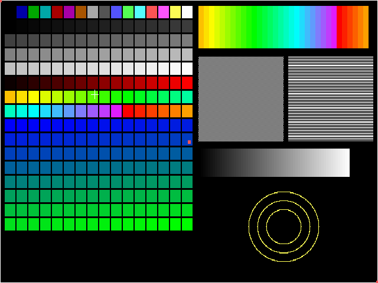

# Platform layer (`platform/`): window, palette, input, timer

Made in session S08. This page covers the thin layer that replaces DirectDraw, the Win32 window and message loop,
and the Windows multimedia timers with SDL3 ([ADR-0004](../decisions/0004-platform-library.md)). It describes how the game
and WIN32LIB reach that layer, and what is still left to wire up before the game can boot (S10). The SDL dependency itself is
[ADR-0020](../decisions/0020-sdl3-via-fetchcontent.md), and how to build it is in [building.md](../building.md#sdl3).

## Summary

- **One header, no SDL types:** `platform/platform.h`. Game code and WIN32LIB include only this header. Only
  `platform/src/platform_sdl.cpp` (and `keymap.cpp` for the key constants) includes SDL.
- **Library `raplatform`** (static) plus the test program **`platform_demo`** (`platform/platform.cmake`). These are
  *real* targets, not compile-progress targets: CI builds them, and the job fails if they break. `win32lib` links `raplatform`
  `PUBLIC`, so the game gets the include path and the library from there.
- **The game keeps drawing into its 8-bit buffers.** The buffer that used to be the DirectDraw primary surface
  (`VisiblePage`, created with `GBC_VISIBLE`) is plain system memory registered with `Platform_Set_Frame_Buffer`. Every present
  converts it through the 256-colour palette into an SDL streaming texture and draws that texture scaled into the window.
- **Input is translated into the game's own key codes**: Windows `VK_*` values plus the `WWKEY_*` bits, exactly what
  `WWKeyboardClass::Put_Key_Message` built from `WM_KEYDOWN`/`WM_LBUTTONDOWN`. Mouse positions are scaled back to game
  (frame-buffer) coordinates.
- **The timer matches the original rate exactly:** a 16 ms tick (`1000/60` in integer arithmetic, as `timeSetEvent` was given),
  which is **62.5 ticks per second, not 60**. It is computed from `std::chrono::steady_clock` when read, with no thread.
- **The pump** (`Platform_Pump_Events`) is called where the game pumped Windows messages (`KEY.CPP` `Fill_Buffer_From_System`). It
  handles OS events, runs registered **poll hooks** (the mouse cursor now, network sockets from S12), and auto-presents
  at most every 16 ms.
- **Single-threaded.** The original drew the mouse cursor and counted ticks from multimedia-timer callback threads.
  Both now run on the game thread, so the critical sections are gone.

## Files

| File | What |
|------|------|
| `platform/platform.h` | The public API (below). Only 32-bit fields in structs, with `static_assert`ed sizes, so the layout is the same under the game's `/Zp1`/`-fpack-struct=1` and the library's default packing |
| `platform/src/platform_sdl.cpp` | SDL back end: window, renderer, texture, palette, event pump, input queue, focus, poll hooks |
| `platform/src/keymap.cpp/.h` | Pure translation SDL keycode/scancode → VK → WW key code → ASCII (unit-tested) |
| `platform/src/viewport.cpp/.h` | Pure maths: where the frame goes in the window, and window → game coordinates (unit-tested) |
| `platform/src/platform_timer.cpp` | Clock, sleep, tick maths (`std::chrono`, no SDL) |
| `platform/demo/platform_demo.cpp` | Test program |
| `platform/platform.cmake` | Targets `raplatform`, `platform_demo` |
| `cmake/RASDL3.cmake` | SDL3 via FetchContent ([ADR-0020](../decisions/0020-sdl3-via-fetchcontent.md)) |
| `tests/platform_*_test.cpp` | Unit tests (`# --- S08 ---` in `tests/tests.cmake`), plus the ctest `platform_demo_offscreen` |

## API (`platform/platform.h`)

| Group | Functions | Replaces |
|-------|-----------|----------|
| Lifetime | `Platform_Init`, `Platform_Shutdown`, `Platform_Last_Error` | — |
| Video | `Platform_Default_Video_Config`, `Platform_Video_Init(config, title)`, `Platform_Video_Shutdown`, `Platform_Video_Is_Open` | `Create_Main_Window`, `DirectDrawCreate`/`SetDisplayMode` (`Set_Video_Mode`) |
| Frame | `Platform_Set_Frame_Buffer(pixels, w, h, pitch)`, `Platform_Present`, `Platform_Set_Present_Interval`, `Platform_Wait_Vertical_Blank` | DirectDraw primary surface, `WaitForVerticalBlank` |
| Palette | `Platform_Set_Palette(rgb768, bits)` (6-bit values are `<< 2`, like `Set_DD_Palette`), `Platform_Get_Palette` | `IDirectDrawPalette::SetEntries` |
| Display | `Platform_Set_Fullscreen`, `Platform_Toggle_Fullscreen` (also **Alt+Enter**, which is not passed to the game), `Platform_Set_Scale_Mode(INTEGER/FIT/STRETCH, aspect_correct)`, `Platform_Show_System_Cursor`, `Platform_Set_Mouse_Clip`, `Platform_Message_Box` | exclusive fullscreen mode, `ClipCursor`, `MessageBox` |
| Input | `Platform_Pump_Events`, `Platform_Get_Input`/`Peek`/`Clear`, `Platform_Get_Mouse_Position`, `Platform_Key_Down`, `Platform_Modifier_Bits`, `Platform_Key_To_ASCII` | `PeekMessage`/`DispatchMessage`, `GetCursorPos`, `GetAsyncKeyState`, `GetKeyState`, `ToAscii` |
| Focus / quit | `Platform_Has_Focus`, `Platform_Set_Focus_Callback`, `Platform_Quit_Requested` | `WM_ACTIVATEAPP`, `WM_CLOSE`/`WM_DESTROY` |
| Poll hooks | `Platform_Add_Poll_Hook(fn, user)`, `Platform_Remove_Poll_Hook` (max 16; a pair is only added once; re-entrant pumps from inside a hook are ignored) | `WSAAsyncSelect` window messages (S12), the mouse timer thread |
| Time | `Platform_Milliseconds`/`64`, `Platform_Sleep`, `Platform_Tick_Period_Ms(freq)`, `Platform_Ticks_In(ms, freq)` | `timeSetEvent`, `timeGetTime`, `Sleep` |

## Video

**Resolution.** The game draws at **640x400** (`ScreenWidth`/`ScreenHeight` in `GLOBALS.CPP`). With `Resolution=1` in
`REDALERT.INI` (`Read_Setup_Options`, `STARTUP.CPP`) it asks for **640x480** and draws its 640x400 view 40 lines down
(`SeenBuff.Attach(&VisiblePage, 0, 40, 640, 400)`). The 320-wide ModeX path is dead in the Win32 build. The platform layer
presents whatever size the visible buffer has.

**Scaling** (`Compute_Viewport`):
- `PLATFORM_SCALE_INTEGER`: the largest whole multiple that fits, with black borders. It falls back to FIT if the window is smaller than 1x.
- `PLATFORM_SCALE_FIT` (default): the largest size that keeps the aspect ratio, with black bars.
- `PLATFORM_SCALE_STRETCH`: fills the window.
- **Aspect correction** (default on): the frame is shown at 4:3, the shape of a 1996 CRT. 640x400 becomes 640x480 units,
  so pixels are 1.2 times taller than wide. 640x480 is unchanged.
- Texture filtering: `NEAREST` for exact whole multiples, otherwise SDL 3.4's `PIXELART` mode (sharp pixels with smoothed edges).
- The window opens at the largest whole multiple of the 4:3 size that fits in 90% of the desktop. It is resizable, high-DPI
  aware (the viewport is computed in output pixels and the mouse is scaled by the pixel density), and has no vsync, because presents
  happen inside the game's busy loops and must not block.

**When is the frame shown?** The game never "flips": it draws straight into the visible page, and DirectDraw showed it
immediately. Now `Platform_Pump_Events` presents whenever 16 ms have passed since the last present, and immediately after a
palette change or a window resize/expose. `Wait_Vert_Blank` presents and then sleeps to the next 1/60 s boundary, so
fades that paced themselves on the retrace keep their speed.

**WIN32LIB changes** (all inside files S08 owns):
- `DRAWBUFF/GBUFFER.CPP`:
  - `DD_Init` allocates system memory instead of a DirectDraw surface and registers the `GBC_VISIBLE` buffer with the platform.
  - `IsDirectDraw` stays `FALSE`, so the C++ blit/fill ports from S07-A are always used.
  - `Lock`/`Unlock` always succeed. `Un_Init` unregisters the visible buffer.
  - `DD_Linear_Blit_To_Linear` is now a software copy. It is unreachable, but kept so the API stays the same.
  - **Class layouts are unchanged** (`GraphicViewPortClass` is mirrored in S07-A's `GVPORT.H`).
- `DRAWBUFF/ICONCACH.CPP`: the video-memory icon cache never caches (`Cache_It` fails), and the DirectDraw calls are gone.
- `MISC/DDRAW.CPP`:
  - `Set_Video_Mode` → `Platform_Video_Init`, and `Reset_Video_Mode` → `Platform_Video_Shutdown`.
  - `Set_DD_Palette` → `Platform_Set_Palette(…, 6)`. This is the entry point S07-C's `PAL.CPP` `Set_Palette` calls.
  - `Wait_Vert_Blank` → `Platform_Wait_Vertical_Blank`.
  - `Get_Free_Video_Memory` returns 0 and `Get_Video_Hardware_Capabilities` returns `VIDEO_NO_HARDWARE_ASSIST`, so the game
    puts its hidden page in system memory.
  - `SurfaceMonitorClass` keeps its API: `Restore_Surfaces` still calls the focus-restore callback and resets the palette.
  - The DirectDraw globals stay defined, always `NULL`.
- `WW_WIN/`: nothing to do. It is text-window bookkeeping with no OS calls ([libraries.md](libraries.md)).

## Input

`Platform_Pump_Events` translates SDL events into a 256-entry queue of `PlatformInputEvent {Type, Key, X, Y}`:

| SDL event | Queued as | Notes |
|-----------|-----------|-------|
| key down / repeat / up | `PLATFORM_INPUT_KEY`, `Key` = VK \| `WWKEY_SHIFT/CTRL/ALT_BIT` \| `WWKEY_RLS_BIT` | Auto-repeat gives more key-downs, like repeated `WM_KEYDOWN` |
| left/right/middle button | `PLATFORM_INPUT_MOUSE`, `Key` = `VK_LBUTTON`/`VK_RBUTTON`/`VK_MBUTTON` (\| `RLS`), `X`,`Y` in game coordinates | No modifier bits on mouse keys ("incompatible with the dos version"). No double-click translation: the window class had no `CS_DBLCLKS` |
| mouse motion | updates `Platform_Get_Mouse_Position` | clamped to the frame |
| focus gained/lost | `Platform_Has_Focus`, focus callback | |
| quit / close | `Platform_Quit_Requested` | |

**Key translation** (`keymap.cpp`):
- Letters and digits follow the SDL *keycode*, which depends on the keyboard layout, just as Windows VKs do (AZERTY 'A' gives `VK_A`).
- Every other key follows the *scancode* (physical position): F-keys, arrows, OEM punctuation `VK_OEM_*`, and so on.
- Keypad keys follow num lock as on Windows: with num lock off, KP7 is `VK_HOME` and KP5 is `VK_CLEAR`.

**Two findings from the old code** that the translation keeps:
1. The original set `WWKEY_SHIFT_BIT` when caps lock or num lock was on, via `GetKeyState(VK_CAPITAL) & 0x0008`.
   Windows reports the toggle state in bit 0, so that test **never fired**. Only a held Shift sets the bit, and we do the same.
2. `To_ASCII` passed `ToAscii` a key-state array that held only Shift/Ctrl/Alt (from the key's own bits), so caps lock was
   ignored. `Platform_Key_To_ASCII` is a US-layout `ToAscii` with the same inputs: Ctrl+letter gives a control code, Ctrl+Alt
   (AltGr) gives nothing, released keys give 0. Non-US text entry (chat) would need SDL text-input events. That is a later improvement.

**How the game reaches it.** In `CODE/KEY.CPP`:
- `WWKeyboardClass::Fill_Buffer_From_System` now calls `Platform_Pump_Events()` and moves the queued events into the
  keyboard buffer with `Put`/`Put_Mouse_Message`, as `Message_Handler` did. Scroll Lock still calls `Stop_Execution`.
- `Put_Key_Message` takes the modifiers from `Platform_Modifier_Bits`, `To_ASCII` from `Platform_Key_To_ASCII`, and `Down` from `Platform_Key_Down`.

**Mouse cursor.** `WWMouseClass` (layout unchanged; the S07-C C++ port of `WWMOUSE.ASM` draws it) still draws the game's own
cursor into the visible page. In `WIN32LIB/KEYBOARD/MOUSE.CPP`:
- The 60 Hz `timeSetEvent` thread is replaced by a platform poll hook that runs `Process_Mouse` on every pump.
- `GetCursorPos` is replaced by `Platform_Get_Mouse_Position`.
- `ClipCursor` is replaced by `Platform_Set_Mouse_Clip`, and the critical sections are gone.

The OS cursor is hidden over the window (`Set_Video_Mode`). Mouse coordinates are frame-buffer coordinates, which is what
`GetCursorPos` returned in the original fullscreen 640x400 mode.

## Timer

`WIN32LIB/TIMER/TIMERINI.CPP` `WinTimerClass` (layout unchanged):
- **Original:** `timeBeginPeriod(1000/freq)` and `timeSetEvent(1000/freq, 1, Timer_Callback, …, TIME_PERIODIC)`. The callback
  incremented `SysTicks` and `UserTicks` on a Windows thread. With `freq = 60` that is a **16 ms** period: **62.5 ticks per
  second**, so a game "second" (`TIMER_SECOND = 60`) is really 0.96 s.
- **Now:** on every `Get_System_Tick_Count`/`Get_User_Tick_Count`, `Update_Tick_Count` adds the whole 16 ms periods that
  passed since the last read (`Platform_Milliseconds`, a steady clock) and carries the remainder over. The rate is the same, and the count is
  monotonic and wrap-safe. The two members the old code never used now hold the clock state: `TrueRate` is the last read, and `UserRate`
  is the leftover milliseconds.
- `TimerClass`, `CountDownTimerClass`, `TickCount`, `CountDown` (`TIMER.CPP`, `TIMERDWN.CPP`) and the game's `SystemTimerClass`
  (`JSHELL.H`) are unchanged. They still read `WindowsTimer`.
- Verified with a harness: 62 ticks per 1000 ms through `TickCount`, a `TimerClass` and a `CountDownTimerClass`.

**Determinism:** none. Lockstep runs on frame numbers, not wall-clock ticks. The tick rate only sets game speed and frame pacing,
and it matches the original.

## Poll hooks and the network (S12)

`WINSTUB.CPP:178-186` routed `PacketTransport->Protocol_Event_Message()` (a `WSAAsyncSelect` notification) to
`PacketTransport->Message_Handler`, so **packets were only read while Windows messages were pumped**. The LAN design
([lan-multiplayer.md](../design/lan-multiplayer.md)) makes sockets polled. S12 registers
`Platform_Add_Poll_Hook(<socket Poll>, transport)`, so packets are read on every pump (every `Keyboard->Check()`), and also polls
from `IPXManagerClass::Service()`. The platform layer only provides the hook. It never touches sockets.

## The test program

`platform_demo` draws a test pattern into an 8-bit 640x400 buffer, as the game draws into `VisiblePage`. The pattern has every palette index,
a 1-pixel border, a checkerboard and circles that are round only when aspect correction is on. The demo cycles palette indices 96-127
on the 60 Hz tick and prints every input event as the game sees it (WW key code, ASCII, mouse position in game
coordinates). Escape quits. F11 or Alt+Enter toggles fullscreen. F1/F2/F3 switch between integer, fit and stretch, and F4 toggles aspect correction.
Options: `--frames N`, `--height 480`, `--fullscreen`, `--integer`, `--stretch`, `--no-aspect`, `--dump file.bmp`.



*Under Xvfb with the real X11 driver, after scripted input: the cursor marker is in the middle-left of the frame, a click marker is in the swatch grid, and the
palette-cycling band at top right is shifted.*

## Remaining integration for S10

The platform layer works, and the WIN32LIB video/timer/mouse back ends and the keyboard pump are rewired. The game cannot link
yet (S06/S07), so these pieces are left. They are listed in boot order. File:line references are to the tree at the end of S08.

1. *(Done in S10b, see [How `main` works](#how-main-works).)* **Entry point.** `WinMain` (`STARTUP.CPP`) becomes `int main(int argc, char **argv)`:
   - Drop the hand-made argv split, `_dos_getdrive`/`_dos_setdrive` and the `FindWindow` single-instance check.
   - Call `Platform_Init()` first. On failure, `Platform_Message_Box("Red Alert", Platform_Last_Error())` and exit.
2. *(Done in S10b: `Create_Main_Window`, `Windows_Procedure`, `Window_Dialog_Box` deleted; the start-up `MessageBox` calls are `Platform_Message_Box`. `MainWindow` stays `NULL` and is still passed to `Audio_Init`, `Set_Video_Mode` (ignored) and the Winsock code (S12). The ~90 dialog/WOL `MessageBox` calls were left: none of them is linked into the Linux build any more.)* **Window.** Delete `Create_Main_Window` (`WINSTUB.CPP:394`) and `Windows_Procedure` (`WINSTUB.CPP:161`). `Set_Video_Mode`
   already opens the window. `MainWindow` is only still passed to `Audio_Init` (S09 decides) and `MessageBox`.
   Replace each `MessageBox(MainWindow, text, title, …)` in `STARTUP.CPP`/`WINSTUB.CPP`/`INIT.CPP` that is shown before
   the game UI exists with `Platform_Message_Box(title, text)`. The other 90-odd `MessageBox` calls are in dialogs/WOL leftovers;
   decide per call.
3. *(Done in S10b: `On_Focus_Change` in `WINSTUB.CPP`, and `MOUSE.CPP` now says `extern bool GameInFocus`. `main` sets `GameInFocus = true` after the window opens, because the platform only reports changes.)* **Focus.** Register a focus callback once after `Platform_Init` that does what `WM_ACTIVATEAPP` did:
   ```cpp
   static void On_Focus(bool in) { GameInFocus = in; if (!in) Focus_Loss();
                                   AllSurfaces.Set_Surface_Focus(in); AllSurfaces.Restore_Surfaces(); }
   Platform_Set_Focus_Callback(On_Focus);
   ```
   `WWMouseClass::Process_Mouse` does nothing while `GameInFocus` is false, so **the cursor will not draw until this is
   done**. Also `GameInFocus` is `bool` in `CODE/GLOBALS.CPP:195` but `extern BOOL` in `GBUFFER.CPP`, `MOUSE.CPP` and
   `SOUNDIO.CPP`, a type mismatch to fix (S06/S10).
4. *(Done in S10b. It does not block: while out of focus it pumps once and sleeps 10 ms, and its callers loop.)* **`Check_For_Focus_Loss`** (`WINSTUB.CPP:112`): replace both `PeekMessage` loops with `Platform_Pump_Events()`. While not in
   focus, sleep (`Platform_Sleep(10)`) and pump until `Platform_Has_Focus()`.
5. *(Done in S10b: a poll hook (`Quit_Poll_Hook`) calls `Emergency_Exit(EXIT_SUCCESS)` when the window is closed, from any loop that pumps; shutdown is `Game_Shutdown` (`WINSTUB.CPP`), also used by `Emergency_Exit`, `Memory_Error_Handler` and `Assert_Failure`.)* **Quit.** Where the main loops run (`Main_Loop`/`Select_Game`), treat `Platform_Quit_Requested()` like the old `SC_CLOSE` (which
   was ignored: Alt+F4 did nothing) or offer the quit dialog. Shutdown (`STARTUP.CPP` after `Main_Game`): replace
   `PostMessage(MainWindow, WM_DESTROY)` plus the `ReadyToQuit` wait loop with a direct call to the `WM_DESTROY` body (`Prog_End`,
   `VisiblePage.Un_Init()`, `HiddenPage.Un_Init()`, `Reset_Video_Mode()`), then `Platform_Shutdown()`. Same for
   `Memory_Error_Handler` (`WINSTUB.CPP:750`).
6. *(Done in S10b: `InitDDraw` is the only video set-up; the inline copy in `WinMain` went with it.)* **`InitDDraw`** (`STARTUP.CPP:487`): the `VisiblePage` `GetCaps` check is removed. Remove the now-unreachable `HiddenPage`
   `GBC_VIDEOMEM` branch (`Get_DD_Surface()->GetCaps`, `Attach_DD_Surface`), the `DDSCAPS` local, and the `#else` copy of the
   same code inside `WinMain` (`STARTUP.CPP:276-375`, compiled only without `MPEGMOVIE`).
7. *(Done in S10b: removed.)* **Timer start-up check** (`STARTUP.CPP:221-228`): `Sleep(1000)` to prove the timer ticks is no longer needed. Use
   `Platform_Sleep` if kept.
8. *(S10b removed `Message_Handler` from `KEY.CPP`/`KEY.H`. `KeyState[256]` and the `<windows.h>` include in `KEY.H` remain.)* **Keyboard.** `WWKeyboardClass::Message_Handler` (`KEY.CPP`) and its `HWND`/`UINT`/`LONG` signature can go with
   `Windows_Procedure`, as can the unused `KeyState[256]` member (only after checking nothing depends on the layout; `KEY.H` is
   not read by asm). `KEY.H` still includes `<windows.h>` only for VK codes, which it defines itself. `WWKeyboardClass::Down` has
   no return type (`KEY.CPP`, implicit int, S06). The library copy `WIN32LIB/KEYBOARD/KEYBOARD.CPP` (a second `WWKeyboardClass`
   with its own message pump; the game's `KEY.CPP` wins at link time) should be dropped from `RA_WIN32LIB_CXX_SOURCES`. *(Done in S06f: removed and deleted.)*
9. *(Done in S10b: `MPEGMOVIE` is no longer defined in `DEFINES.H`; VQA movies are stubbed too, see [stubs.md](stubs.md).)* **MPEG movies.** `CONQUER.CPP:2468-2610` (`Play_Movie` under `MPEGMOVIE`/`DVD`) uses `DirectDrawObject`, `PaletteSurface` and
   `PalettePtr` directly for the DVD MPEG player (`mpgdll`, not in the repo). With S08 these are `NULL`. Turn `MPEGMOVIE` off
   (VQA movies are unaffected) or remove that path.
10. **Icon cache** (ADR-0016, S07-A): delete `ICONCACH.CPP`/`.H`, the cache branch of `Draw_Stamp` in
    `GBUFFER.H`, `IconCacheAllowed`, the `Register_Icon_Set` call at `CODE/CDATA.CPP:3136`, `Invalidate_Cached_Icons`/
    `Restore_Cached_Icons` calls (`WINSTUB.CPP:87`, `:223`), and S07-A's stand-in `WIN32LIB/DRAWBUFF/STMPCACH.CPP`.
    S08 made the cache inert, but did not delete it because the stand-in is S07-A's file.
11. *(S10b deleted `Colour_Debug`. `Blit_Display`'s 320-wide branch and `WINASM.CPP`'s `ModeX_Blit`/`Set_Palette_Register` remain.)* **320-wide leftovers** (from S07-C): remove the 320-wide branch of `GScreenClass::Blit_Display` and `Colour_Debug`
    (`WINSTUB.CPP:516`), then the empty `ModeX_Blit` and `Set_Palette_Register` in `CODE/WINASM.CPP`.
12. **Sockets** (S12): register the transport's poll with `Platform_Add_Poll_Hook`, and drop the
    `PacketTransport->Message_Handler` routing in `Windows_Procedure`.
13. **Options.** Read fullscreen/scale/aspect preferences (for example `[Video] Fullscreen=`, `Scale=`, `AspectCorrect=` in
    `REDALERT.INI`) in `Read_Setup_Options` and pass them through a `PlatformVideoConfig`. `Set_Video_Mode` currently uses the defaults:
    windowed, FIT, 4:3.
14. *(Done in S10b: the call went with `Windows_Procedure`.)* **Profiler** (`WINSTUB.CPP:236` `Stop_Profiler`, `WIN32LIB/PROFILE`): uses `timeSetEvent`. Delete it (developer tool, libraries.md). *(S06f took `WPROFILE.CPP`/`APROFILE.ASM` out of the build; the `Stop_Profiler()` call in `WINSTUB.CPP` is now unresolved and must be deleted.)*

Still open after S10b: 10 (icon cache), the rest of 11, 12 (S12) and 13 (video options).

## How `main` works

Since S10b `CODE/STARTUP.CPP` has a portable `int main(int argc, char *argv[])` (no `WinMain` on any host; MSVC links
with `/ENTRY:mainCRTStartup` because the target is still a `WIN32_EXECUTABLE`). In order:

1. `Platform_Init()`. On failure: `Platform_Message_Box(title, Platform_Last_Error())`, exit code 1.
2. `Install_Platform_Callbacks()` (`WINSTUB.CPP`): the focus callback `On_Focus_Change` (what `WM_ACTIVATEAPP` did),
   the poll hook `Quit_Poll_Hook` (window closed → `Emergency_Exit(EXIT_SUCCESS)`), and the focus-loss function
   pointers `Create_Main_Window` used to set.
3. The RAM check (`Ram_Free`, always 64 MB), then `chdir` to the executable's directory, as the original did
   (`_splitpath(argv[0])`). **S10c**: the asset-path setting will have to decide whether this stays.
4. `Parse_Command_Line(argc, argv)` with the real `argv`. Then `WinTimerClass(60)`, `KeyboardClass`, the compressed-shape
   check and the disk-space warning (now a plain message box; the game continues, as "yes" did).
5. `REDALERT.INI` (`CONFIG_FILE_NAME`, found case-insensitively). Missing: message box "Run SETUP program first",
   exit code 0 (the original waited for a key without a window). Present: `Read_Private_Config_Struct`,
   `Read_Setup_Options`, `Audio_Init(NULL, …)`, `InitDDraw()` (window via `Set_Video_Mode`, `VisiblePage`/`HiddenPage`,
   `SeenBuff`/`HidPage`), `GameInFocus = true`, mouse, CD drive (none), intro flag, `Main_Game`.
6. On return: `Game_Shutdown(false)` (the old `WM_DESTROY` body: `Prog_End`, icon cache, pages, `Reset_Video_Mode`,
   then `Platform_Shutdown`).

