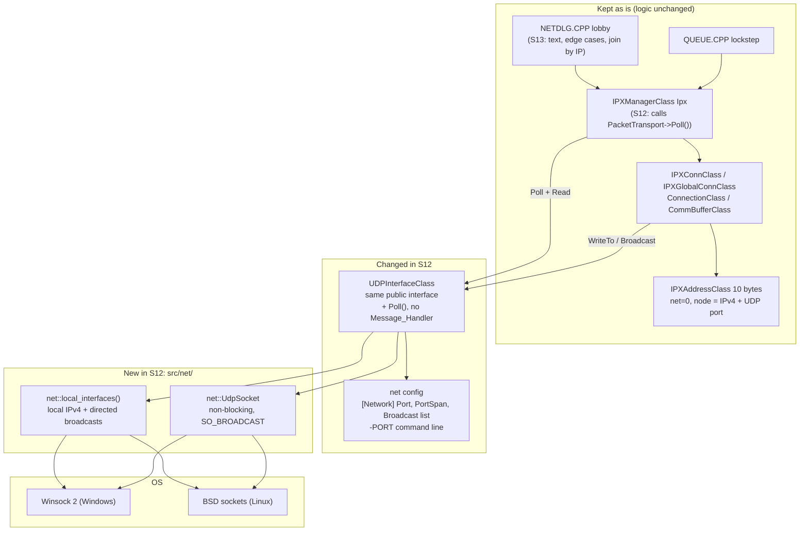
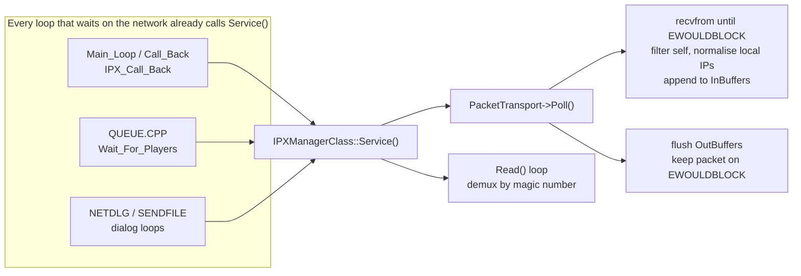
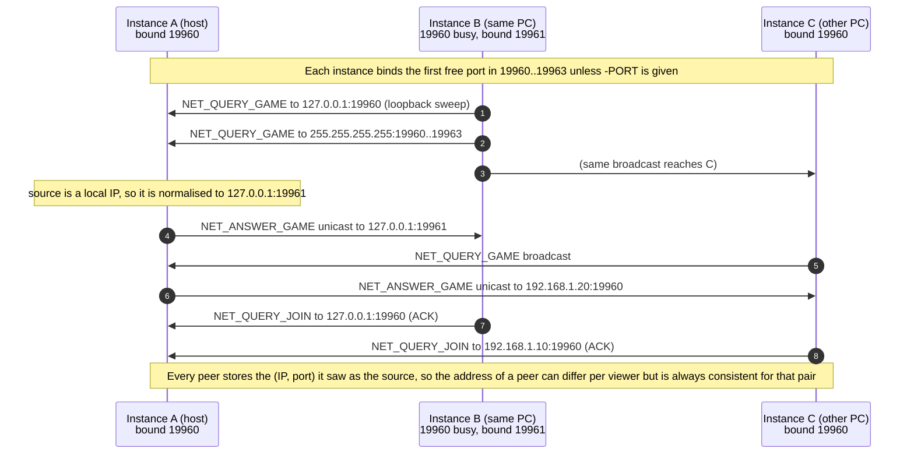

# Design: LAN multiplayer (milestone M3)

- **Status:** Proposed (session S04, 2026-10-14). The decision record is [ADR-0007](../decisions/0007-lan-udp-transport.md).
- **Consumers:** S12 (portable sockets), S13 (LAN discovery, lobby, game start), S14 (sync harness).
- **Background:** [`../codebase/networking.md`](../codebase/networking.md) describes the original stack this design builds on.
  Read its *Summary* first.

## Goal and scope

2–4 friends on the same LAN (or on one PC, for testing) can find each other's games, join, start, and
finish a game without desyncs, on Windows and Linux.

In scope:
- the UDP transport;
- discovery;
- ports;
- addressing;
- running several instances on one machine;
- version checks;
- wire-layout stability;
- the test plan.

Out of scope for M3 (only touched on in [Later: internet play](#later-internet-play-m4)):
- NAT traversal, relays, a lobby server;
- IPv6;
- encryption and authentication;
- reconnecting after a drop;
- spectators;
- more than 8 players (the existing `CONNECT_MAX` limit).

## Decisions in one table

| Topic | Decision |
|---|---|
| Overall approach | **Keep** the lobby (`NETDLG`), the lockstep (`QUEUE`) and the whole connection layer (`IPXManagerClass`, `IPXConnClass`, `IPXGlobalConnClass`, `ConnectionClass`, `CommBufferClass`). **Replace** only the transport internals under the unchanged `PacketTransport` interface |
| LAN transport | `GAME_IPX` creates `UDPInterfaceClass` instead of `IPXInterfaceClass` (`INIT.CPP:1255`). Native IPX goes (S05) |
| Event loop | No window messages. The transport gets `Poll()`, called from `IPXManagerClass::Service()` (and harmlessly from the main loop). `WriteTo` sends immediately |
| Sockets | New `net::` wrapper over Winsock 2 and BSD sockets: non-blocking IPv4 UDP, `SO_BROADCAST`, interface enumeration |
| Address | Keep the 10-byte `IPXAddressClass`. For UDP: network = `0.0.0.0`, node = 4-byte IPv4 + **2-byte UDP port** (both network byte order). Port 0 means "the base port" |
| Default port | **19960/udp** (mnemonic: 1996; confirmed by the owner, [ADR-0013](../decisions/0013-lan-scope-port-crossplay-naming.md)). Each instance binds the first free port in `19960..19963` |
| Configuration | `REDALERT.INI [Network] Port=19960`, `PortSpan=4`, `Broadcast=` extra targets. Command line `-PORT=<n>` binds exactly that port (no fallback) |
| Discovery | Keep the original broadcast query protocol unchanged. Send each broadcast to `255.255.255.255`, to each interface's directed broadcast, to `127.0.0.1`, and to configured extra targets, for every port in the span |
| Same-machine play | Port fallback plus loopback targets. Packets from any local IP are normalised to `127.0.0.1:port`. Only packets from **our own port** on a local IP are dropped |
| Join by IP | A text field in the join dialog fills `Session.BridgeNet` and sets `Session.IsBridge`. The existing code then unicasts every query there too (`NETDLG.CPP:3274-3277`) |
| Version check | Our own `NET_PROTOCOL_VERSION`, replacing `GAME_VERSION` from `RAWOLAPI.H`. Exact match required. Uses the existing `REJECT_VERSION_TOO_OLD/NEW` path |
| Wire layout | Every struct that goes on the wire gets `static_assert`s on size and key offsets. They must hold on MSVC and GCC/Clang. The original Watcom sizes are the starting point; we may change them ([ADR-0009](../decisions/0009-own-network-protocol.md)) |

## Architecture: keep versus replace



| Component | M3 verdict | Why |
|---|---|---|
| `QUEUE.CPP` lockstep, `EventClass` | Keep, no logic changes | It works, it's transport-agnostic, and any change risks desyncs |
| `NETDLG.CPP` Join/New dialogs, `SENDFILE.CPP` | Keep. S13 changes text, adds join-by-IP, shows the version, and fixes edge cases | Complete lobby protocol, including scenario transfer |
| `IPXManagerClass`, `IPXConnClass`, `IPXGlobalConnClass`, `ConnectionClass`, `CommBufferClass`, `IPXAddressClass` | Keep. One added call (`Poll()`) in `Service()` | Reliability, ordering and demultiplexing over datagrams are already done |
| `UDPInterfaceClass` / `WinsockInterfaceClass` | Keep the **interface**, rewrite the **internals** | It is the Windows-message-driven part |
| `IPXInterfaceClass`, IPX DLL and real-mode code | Remove (S05) | Not usable on modern systems |
| `UDPADDR.CPP` (`IP.INI` dialog) | Replace with `[Network] Broadcast=` and join by IP | Same purpose, simpler |
| Class names (`IPX*`, `GAME_IPX`) | **Keep for M3** | Renaming touches dozens of files and conflicts with parallel sessions. A later cleanup can rename them under its own ADR. The UI already says "Network" |

## Transport design (S12)

### Socket wrapper: `src/net/` (new)

```cpp
namespace net {
    bool startup();                 // WSAStartup(2.2) on Windows, no-op elsewhere. Idempotent.
    void shutdown();

    struct Endpoint { uint32_t ip_be; uint16_t port_be; };   // network byte order

    struct Interface { uint32_t ip_be; uint32_t broadcast_be; };   // IPv4 only
    std::vector<Interface> local_interfaces();   // GetAdaptersAddresses / getifaddrs, up interfaces only

    class UdpSocket {
    public:
        bool open(uint16_t port);      // AF_INET/SOCK_DGRAM, bind INADDR_ANY:port, non-blocking,
                                       // SO_BROADCAST on, 128 KB buffers. On Windows SO_EXCLUSIVEADDRUSE.
                                       // No SO_REUSEADDR (two instances must not share a port).
        void close();
        uint16_t bound_port() const;
        // > 0: bytes received. 0: nothing pending. < 0: error (logged, ignored by the caller)
        int recv_from(void *buf, int len, Endpoint *from);
        enum class Send { Ok, WouldBlock, Error };
        Send send_to(const void *buf, int len, const Endpoint &to);
    };
}
```

- Windows needs `WSAEWOULDBLOCK`/`WSAECONNRESET` handling. `WSAECONNRESET` is reported on UDP
  sockets after an ICMP port-unreachable; ignore it, or turn it off with `SIO_UDP_CONNRESET` (**unverified**
  which is cleaner). Linux needs `EAGAIN`/`EWOULDBLOCK`/`ECONNREFUSED`, and `EINTR` retried.
- No threads. The game is single-threaded and the lockstep relies on that.

### `UDPInterfaceClass` after S12

Its public interface (`Init`, `Open_Socket`, `Start_Listening`, `Stop_Listening`, `Read`, `WriteTo`,
`Broadcast`, `Discard_In_Buffers`, `Discard_Out_Buffers`, `Close_Socket`, `Get_Protocol`,
`Set_Broadcast_Address`) stays the same, so the connection layer is untouched. Changes:

1. **`Message_Handler`, `Protocol_Event_Message`, the `WM_*ASYNCEVENT` defines and the `WINSTUB.CPP`
   hook (`WINSTUB.CPP:180-193`) are removed.** `Start_Listening()` just marks the socket active.
2. **New `virtual void Poll()`**, implemented in the base class:
   - **receive:** `recv_from` until nothing is pending, at most 64 datagrams per call so a flood can't
     stall a frame;
   - apply the self-filter and normalisation below;
   - append to `InBuffers`;
   - **send:** flush `OutBuffers` and stop at the first `WouldBlock`, **keeping** that packet. The
     original deleted it (`WSPUDP.CPP:415-426`).
3. **`WriteTo` / `Broadcast` try to send immediately.** On `WouldBlock` they queue to `OutBuffers`. The
   `SendMessage` and `Keyboard->Check()` calls go.
4. **`Read()` calls `Poll()` first if `InBuffers` is empty**, then pops one packet. The
   `Keyboard->Check()` call goes. Pumping input from deep inside the network code is the platform layer's
   business (S08), not the transport's.
5. **`IPXManagerClass::Service()`** calls `PacketTransport->Poll()` at the top of its `WINSOCK_IPX`
   branch (`IPXMGR.CPP:996`).

**Why `Service()` and not "once per frame from the main loop"** (as the S12 brief says): the game blocks
in nested loops that never return to the main loop, and they all call `Service()`:
- `Wait_For_Players` (`QUEUE.CPP:960-1256`);
- the lobby dialogs;
- `NET_GO`'s "wait for all ACKs" (`NETDLG.CPP:5073-5075`);
- `SENDFILE.CPP`.

Today these loops work because `Keyboard->Check()` pumps window messages. Polling in `Service()` keeps
them working without that hidden dependency. A main-loop poll can be added too; it's harmless.



Also in S12:
- **Remove the static-init `WSAStartup`** in the `IPXManagerClass` constructor (`IPXMGR.CPP:126-139`).
  `Is_IPX()` should report `net::startup()` success at the time of the call.
- `WinsockBufferType` keeps its 64-byte address and 1024-byte payload. The largest datagram is 527 bytes.
- Logging: one line per socket open/close and bind fallback, and counters (packets in/out, drops, would-block).

### Address encoding

The transport's 64-byte address buffer and `IPXAddressClass` (10 bytes, cast directly in
`IPXMGR.CPP:1004`) share one layout:

| Bytes | `IPXAddressClass` field | UDP meaning |
|---|---|---|
| 0..3 | `NetworkNumber[0..3]` | always `00 00 00 00` |
| 4..7 | `NodeAddress[0..3]` | IPv4 address, network byte order (as today, `WSPUDP.CPP:369,405`) |
| 8..9 | `NodeAddress[4..5]` | **new:** UDP port, network byte order. `00 00` = base port |

- `IPXAddressClass::operator==` already compares all 6 node bytes when the network number is 0
  (`IPXADDR.CPP:331-346`). So **two instances on one IP are automatically different connections**, with
  no change to the connection layer.
- `WriteTo` already copies `sizeof(IPXAddressClass)` = 10 bytes (`WSPROTO.CPP:446`), so the port reaches
  the transport.
- The all-`0xff` default address still means "broadcast" (`IPXADDR.CPP:285-303`).

### Receive filter and normalisation

For every received datagram, with source `ip:port`:
1. If `ip` is one of our local interface addresses or in `127.0.0.0/8`, rewrite it to `127.0.0.1`.
   This makes a same-machine peer look the same whether its packet came through a broadcast, a loopback
   or a LAN address.
2. If that gives `127.0.0.1:<our bound port>`, drop it: it's our own broadcast. Today any local IP is
   dropped (`WSPUDP.CPP:358-360`), which kills same-machine play. Dropping only our own port keeps the
   original UDP behaviour of never hearing yourself, which the lobby relies on: a joiner must not answer
   its own `NET_QUERY_PLAYER` (`NETDLG.CPP:1120`).

## Ports and configuration

- **Default base port: 19960/udp.** Chosen as an easy mnemonic. It's in the IANA registered range, not
  the ephemeral range, so the OS won't hand it out for outgoing connections. Whether IANA has assigned it
  to anything is **unverified**; check the registry before S12 merges. The original's 1234 is avoided
  because other games (OpenRA, **unverified**) use it.
- **Span: 4** (`19960..19963`), enough for 4 instances on one PC.
- **Binding:**

  | Situation | Behaviour |
  |---|---|
  | `-PORT=<n>` on the command line | Bind exactly `n`; fail loudly if busy |
  | Otherwise | Try `Port`, `Port+1`, … `Port+PortSpan-1` and take the first free one |
  | All busy | The Network button shows an error message instead of silently disappearing |

- **Settings** in `REDALERT.INI`, next to the existing `[MultiPlayer]` section (`SESSION.CPP:745-758`):

  ```ini
  [Network]
  Port=19960          ; base port; all players on a LAN must use the same base port
  PortSpan=4          ; how many ports to try and to broadcast to
  Broadcast=          ; optional comma-separated extra targets, ip or ip:port (VPNs, odd subnets)
  ```

- The lobby shows `Port <n>` for the bound port (S13). That makes two-instance testing self-explanatory.
- On Windows, the first bind triggers the firewall prompt. The release notes (S15) must say to allow it
  for private networks.

## Discovery and broadcast

The protocol is unchanged: `NET_QUERY_GAME` every 120 ticks, `NET_QUERY_PLAYER` every 35 ticks,
`NET_CHAT_ANNOUNCE` every 83 ticks, all with no ACK, plus unicast ACK'd answers
(`NETDLG.CPP:3229-3331`). Only *where a broadcast goes* changes.

`UDPInterfaceClass::Broadcast()` sends one copy to every port in `[Port, Port+PortSpan)` on each of these
targets:
1. `255.255.255.255` (limited broadcast);
2. the directed broadcast address of every up, non-loopback IPv4 interface. On a multi-homed Windows PC
   the limited broadcast may only leave through one interface (**unverified**; the directed broadcasts
   cover it either way);
3. `127.0.0.1`, so instances on the same machine find each other even with no network at all;
4. every `[Network] Broadcast=` entry.

Up to (3 + interfaces) × 4 small packets every 2 s is negligible on a LAN.

- **Duplicates are expected and harmless.** A host may get the same query 2–3 times. It answers each one
  (no ACK on queries), and the joiner de-duplicates games by name (`NETDLG.CPP:3410-3420`). ACK'd
  packets are de-duplicated by the Global Channel's last-4 (address, ID) ring (`IPXGCONN.CPP:225-235`).
  Because of normalisation, a same-machine host always appears as `127.0.0.1:port`, never twice with two
  addresses.
- **Join by IP (S13).** The join dialog gets an "IP[:port]" field for networks where broadcast doesn't
  work (Wi-Fi client isolation, VPNs, different subnets). It sets `Session.IsBridge = 1` and
  `Session.BridgeNet` to that address. The existing code then also sends every query unicast to it
  (`NETDLG.CPP:3274-3277`, `3302-3305`, `3325-3328`). `Ipx.Set_Bridge()` is already a no-op under
  `WINSOCK_IPX` (`IPXGCONN.CPP:509-514`). This is also the path to direct-connect internet play (M4).

## Running two (or more) instances on one machine



- No configuration is needed: start the game twice and the second instance takes port 19961.
- Use `-PORT=` to pin ports in scripts (for example S14's automated games).
- The game never sends addresses inside packets (`GlobalPacketType` and `EventClass` have no address
  fields), so per-viewer addresses are safe. Each peer only uses the address it saw as the source.
- Other per-instance resources that may clash on one machine are **not networking**, and S13 must check
  them:
  - `REDALERT.INI` (handle and colour): two instances need different handles, or the host rejects the
    second with `REJECT_DUPLICATE_NAME` (`NETDLG.CPP:5274-5287`). Add `-NAME=<handle>` or a
    `-CONFIG=<file>` switch;
  - save files;
  - debug files written to the current directory (`OUT.TXT`, `recon.txt`, `toolate.txt`, `badcount.txt`).
- Window focus: both instances must keep running when unfocused. Today `GameInFocus` pauses the game
  (`WINSTUB.CPP:286-297`), which would stall the lockstep for the other instance. **S08/S13 must keep
  simulating in the background in multiplayer.** (**Unverified** how far the focus-loss handling goes;
  check during S13.)

## Game start and the "IPX" name

- `INIT.CPP:1252-1256`: create `UDPInterfaceClass` for `GAME_IPX`. Drop the commented-out protocol
  choice and the `Get_Broadcast_Addresses()` dialog.
- `IPXManagerClass::Init()` already opens and binds the socket for every type except `GAME_INTERNET`
  (`IPXMGR.CPP:373-375`). Make `Open_Socket` idempotent, because `Init()` runs every time the Network
  menu is entered.
- The button label stays `TXT_NETWORK`. If the string table says "IPX", S13 overrides the label with a
  literal "LAN" (**unverified** what it says).

## Version and compatibility checks

What is checked today, and what we keep:

| Check | Where | Keep? |
|---|---|---|
| Version range overlap → `REJECT_VERSION_TOO_OLD` / `TOO_NEW` | Host on `NET_QUERY_JOIN` (`NETDLG.CPP:5340-5371`) using `VerNum.Min/Max_Version()` = `GAME_VERSION` | **Keep the mechanism.** Replace the value with our own `NET_PROTOCOL_VERSION` in `VERSION.H` (S05 moves it out of `RAWOLAPI.H`). Min = Max (exact match) |
| `rules.ini` identity (`CheatCheck` = `RuleINI.Get_Unique_ID()`) → `REJECT_MISMATCH` | `NETDLG.CPP:5305-5311` | Keep. Players with different rules desync |
| Aftermath flag in bit 31 of `MinVersion` / `Version` | `NETDLG.CPP:3082-3091,5322-5339` | Keep as is (asset-dependent). Owner confirmed: [ADR-0011](../decisions/0011-expansions-in-multiplayer.md) |
| Scenario CRC in `FRAMESYNC` → `RC_SCENARIO_MISMATCH` | `QUEUE.CPP:1914-1916` | Keep |
| Game-state CRC every frame | `QUEUE.CPP:3444-3509` | Keep. S14 improves the reporting |

Rules for `NET_PROTOCOL_VERSION`:
- **Bump it on any change** to:
  - a wire struct (sizes, offsets, enum values);
  - event semantics;
  - simulation code that can change results (CLAUDE.md already requires calling those out);
  - the `rules.ini` interpretation.
- Encode it as `0x0004mmmm` (major 4 = "this port", `mmmm` = a counter) so it can never equal an
  original version.
- Show the version in the lobby. S13 should **also** add a `u32 Version` to `GameInfo` in
  `NET_ANSWER_GAME` (the union has room: `GameInfo` uses 4 of 125 bytes) so the join list can grey out
  incompatible games instead of failing at join time.
- Never move `Command`, `Name` or `PlayerInfo.MinVersion/MaxVersion`. Their offsets (0, 2, 20, 24) are
  what let two **different** versions still exchange a clean rejection. The layout asserts below pin them.
- `GLOBAL_MAGICNUM` (0x1235) and `COMMAND_AND_CONQUER0` (0xaa00) stay, so old and new builds of this
  port can still see each other's games and report the mismatch.

## Keeping network structs layout-stable

The wire format is the raw memory of byte-packed structs (see the packing table in the codebase page).
Modern compilers change it silently:
- 4-byte enums turn `EventClass` from 20 into 32 bytes;
- GCC's default bitfield layout shrinks `SpecialClass` to 2 bytes and moves `ScenarioInfo`.

Requirements:
1. ~~**Hard requirement:** identical layout on every compiler and OS we ship (MSVC x86, GCC/Clang x86
   Linux). A Linux player must be able to join a Windows host.~~ **Changed by
   [ADR-0013](../decisions/0013-lan-scope-port-crossplay-naming.md):** cross-play isn't required for M3. The layout must
   be stable and asserted per compiler; cross-compiler matching is a later, optional task.
2. **Target values:** start from the original Watcom sizes. We don't need compatibility with original clients
   ([ADR-0009](../decisions/0009-own-network-protocol.md)), so these may change when that's simpler, as long as rule 1 holds. They're proven: 26 events per 520-byte packet, under the
   historic 546-byte limit, and far below any MTU.
3. **Mechanism (S06/S12):**
   - wrap network headers in `#pragma pack(push, 1)` / `pop`;
   - give every enum used in a wire struct a fixed underlying type (`enum EventType : unsigned char`,
     `NetCommandType : short`, `HousesType : signed char`, …);
   - make bitfields lay out MSVC-style on GCC/Clang (`-mms-bitfields`, or replace the wire bitfields with
     explicit integer fields);
   - giving enums fixed underlying types changes in-memory sizes elsewhere but not arithmetic. It still
     needs an S14 check, as CLAUDE.md requires for anything near the simulation.
4. **Enforcement:** one translation unit, `net/wire_layout_check.cpp`, compiled into every build:

```cpp
static_assert(sizeof(CommHeaderType)   == 7,   "CommHeaderType wire size");
static_assert(sizeof(GlobalHeaderType) == 9,   "GlobalHeaderType wire size");
static_assert(sizeof(IPXAddressClass)  == 10,  "IPXAddressClass wire size");
static_assert(sizeof(EventClass::EventType) == 1, "compressed events store a 1-byte type");
static_assert(offsetof(EventClass, Data) == 5, "EventClass header");
static_assert(sizeof(EventClass)       == 20,  "EventClass wire size");
static_assert(sizeof(SpecialClass)     == 4,   "SpecialClass wire size");
static_assert(sizeof(GlobalPacketType) == 139, "GlobalPacketType wire size");
static_assert(offsetof(GlobalPacketType, PlayerInfo.MinVersion) == 20, "version fields must never move");
static_assert(offsetof(GlobalPacketType, PlayerInfo.MaxVersion) == 24, "version fields must never move");
static_assert(offsetof(GlobalPacketType, ScenarioInfo.Seed) == 69,    "ScenarioInfo layout");
static_assert(offsetof(GlobalPacketType, ScenarioInfo.Special) == 73, "ScenarioInfo layout");
static_assert(sizeof(RemoteFileTransferType) == 198, "file transfer packet size");
static_assert(MAX_IPX_PACKET_SIZE == 520, "26 events per game packet");
```

- Little-endian is assumed (x86 and ARM in practice). Add `static_assert` on the byte order rather than
  byte-swapping.
- 64-bit (a later ADR): `EventClass::Data.Variable.Pointer` becomes 8 bytes. The union stays 15 bytes,
  but the assert will catch any surprise. Add a static_assert on `Variable` as well.
- `Queue_Record` writes raw `EventClass`es (`QUEUE.CPP:3602-3630`), so recordings inherit the same
  guarantees, which S14 relies on.

## Lockstep: what changes

Nothing in `QUEUE.CPP`'s logic. These parameters stay as they are:
- `FrameSendRate` 3;
- `MaxAhead` from the measured response time, at least 6 at start and at least 9 after the first
  `TIMING`;
- re-tuning every 128 frames;
- a 32-frame CRC history;
- 30 s to drop a silent peer.

They are well suited to a LAN. Two transport-level additions help testing, are off by default, and are
for S12 to add and S14 to use:

```ini
[Network]
DebugDropPercent=0   ; randomly drop this % of outgoing datagrams (never in release defaults)
DebugDelayMs=0       ; hold outgoing datagrams this long before sending
```

They exercise the ACK/retry, the reconnect dialog and the `TIMING_FIX` path deterministically, without
real bad networks. The random choice must use its own RNG, **never** the game's `Scen.RandomNumber`.

## Edge cases S13 must handle (and how the code behaves today)

| Case | Today | M3 target |
|---|---|---|
| Joiner leaves the lobby | `Unjoin_Game` sends an ACK'd `NET_SIGN_OFF` to players and host (`NETDLG.CPP:3130-3196`) | Keep. Test it |
| Host leaves the lobby | Host sends `NET_SIGN_OFF`. Joiners drop the game from the list (`NETDLG.CPP:3765-3780`) | Keep. Joiners must return to the browser with a message |
| Host never answers (crash) | Games are aged out by `Game.LastTime` (**unverified** timeout) | Confirm, and show "game timed out" |
| Version or rules mismatch | `NET_REJECT_JOIN` with the reason | Show a clear message including both versions |
| Duplicate handle (two instances, one INI) | `REJECT_DUPLICATE_NAME` | `-NAME=` switch, or auto-suffix |
| Port busy or socket error | Button silently hidden (`MPLAYER.CPP:142,194`) | Message with the port number |
| Player drops mid-game | Reconnect dialog, then after 30 s the house goes to the AI | Keep. Log it in the session log |
| Desync | `OUT.TXT` + Continue/Stop box | S14 adds frame number and a dump |
| Map missing on joiner | `NET_REQ_SCENARIO` → `SENDFILE` transfer | Keep. Test it |

## Test plan

**S12, automated, in CI on Windows and Linux** (no game assets needed):
1. `net::UdpSocket`:
   - open, bind, then a non-blocking receive on an empty socket returns 0;
   - send/receive on `127.0.0.1` between two sockets on different ports;
   - a 527-byte datagram arrives intact;
   - the second `open()` on the same port fails;
   - broadcast to `255.255.255.255` is received by a socket on the target port. Skip with a notice if the
     CI runner has no broadcast route.
2. `UDPInterfaceClass` contract, ideally without linking the whole game (S12 may need to drop
   `WSPROTO.CPP`'s `#include "function.h"`):
   - port fallback in the span;
   - `-PORT` exact bind;
   - address encoding round trip (IP and port in node bytes);
   - `IPXAddressClass` equality differs by port;
   - self-filter drops only our own port;
   - local-address normalisation;
   - `Broadcast()` reaches an instance on base+1 through loopback;
   - `WouldBlock` keeps the packet queued.
3. `wire_layout_check.cpp` compiles on MSVC and GCC/Clang. The static_asserts are the test.

**S13, manual, then scripted where possible:**

4. Two instances on one PC, with no config: find, join, change options, chat, start, play 5 minutes,
   quit. Repeat with `DebugDropPercent=10`.
5. Two PCs on one LAN (one Windows, one Linux once both build): same steps.
6. Three and four players (mix of same-PC and other-PC instances).
7. Lobby edge cases from the table above: joiner leaves, host leaves, version mismatch (build with a
   bumped `NET_PROTOCOL_VERSION`), rules.ini mismatch, missing custom map, duplicate handle, port busy.
8. Kill a client mid-game: the others see the reconnect dialog, then continue with the house under AI
   control after 30 s.
9. Join by IP with broadcast blocked (firewall rule or different subnet).

**S14, automated determinism:**

10. Record a LAN game (`Queue_Record`). Replay it twice and on both compilers; per-frame CRC logs must be
    identical.
11. A mixed-compiler LAN game (MSVC host, GCC joiner) must not desync. This is the real proof that the
    layout work is right.
12. CI catches an intentionally introduced desync.

**M3 acceptance (S15):** a playtest report with at least 3 full LAN games of 2–4 players (vision.md).

## Risks

| Risk | Likelihood | Impact | Mitigation |
|---|---|---|---|
| Struct layout differs between compilers, causing garbage or a silent desync between Windows and Linux players | High without the work above | High | Fixed enum types, packing, the static_asserts, and the mixed-compiler test (10, 11) |
| Hidden reliance on `Keyboard->Check()` re-entrancy: some loop waits for packets but never calls `Service()` | Medium | Hangs | Poll in `Read()` and `Service()`. `grep` for wait loops in S12. A lobby smoke test |
| Broadcast doesn't reach peers: Wi-Fi client isolation, VPN adapters, Windows multi-NIC, firewalls | Medium | Can't find the game | Directed broadcasts, `Broadcast=` list, join by IP, firewall note in the release docs |
| Windows Firewall blocks inbound UDP silently | High on first run | Can't join | Documented, and a clear "no answer from host" message |
| Window focus loss pauses one instance and stalls everyone | Medium | Two-instance testing breaks | Keep simulating in the background in multiplayer (S08/S13) |
| Port 19960 is used by something else on a user's machine | Low | Bind falls back or fails | Span fallback, `[Network] Port=`, `-PORT=` |
| Duplicate packets from multiple broadcast targets confuse the lobby | Low | Odd lists | De-duplication by name and address already exists. Covered by test 4 |
| Global singletons (`Ipx`, `PacketTransport`, `Session`) prevent in-process multi-peer tests | Certain | Tests must use processes | Transport-level unit tests plus process-level tests |
| No authentication; anyone on the LAN can send packets | Certain | Acceptable on a LAN | Revisit for M4+ |
| Lockstep stalls on a slow machine (everyone runs at the slowest player's frame rate) | By design | Feel | Already handled by the `PROCESS_TIME`/`TIMING` negotiation |

## Later: internet play (M4+)

Not designed here, but the M3 design shouldn't block it:
- **Direct connect (M4):** join by IP:port already works over the internet if the host forwards the UDP
  port. Timeouts are already scaled for the internet type (`timeout_factor = 6`, `QUEUE.CPP:568`). Reuse
  that by giving the "internet" path a flag rather than a new game type.
- **NAT:** the original handled NAT by learning a player's real address from their first `FRAMESYNC`
  (`IPXMGR.CPP:1029-1068`). A rendezvous service could do UDP hole punching. Address encoding already
  carries the port, which hole punching needs.
- **Relay:** for symmetric NATs, a relay (tunnel) server can sit **under** `UDPInterfaceClass` by
  wrapping datagrams in a small relay header. The connection layer would not change.
- **Lobby server (M5):** replaces broadcast discovery. The lobby protocol (`NET_QUERY_*`, `NET_ANSWER_*`)
  can be served by a server or mapped to a new one. The join/options/go flow stays peer-to-peer or moves
  to the server; that is an M5 ADR.
- **Security (M5/M6):** packet authentication, anti-spoofing, and the CRC as a weak anti-cheat signal.
  Ranked play needs a trusted result report.
- **IPv6:** the 10-byte address can't hold an IPv6 address. Supporting it means growing
  `IPXAddressClass`, a wire-format change with its own ADR.

## Work split

| Session | Takes from this design |
|---|---|
| S05 | Keep the list in [networking.md § What S05 can remove](../codebase/networking.md#what-s05-can-remove-and-what-must-stay). Move `PlanetWestwoodPortNumber` and `GAME_VERSION`. Extract the skirmish dialog from `NULLDLG.CPP` |
| S06 | Enum underlying types, packing and bitfield layout for wire structs. Add `wire_layout_check.cpp` (or S12 adds it) |
| S12 | `net::` wrapper, `UDPInterfaceClass` rewrite (`Poll`, address port bytes, self-filter, normalisation, broadcast targets), port config and fallback, debug drop/delay knobs, tests 1–3 |
| S13 | `GAME_IPX` → UDP, LAN label, version in `NET_ANSWER_GAME` and in the lobby, join by IP, port display, `-NAME=`, edge cases, tests 4–9, the lobby-flow section in `networking.md` |
| S14 | Tests 10–12, desync reporting, uses `-PORT=` and the debug knobs |
