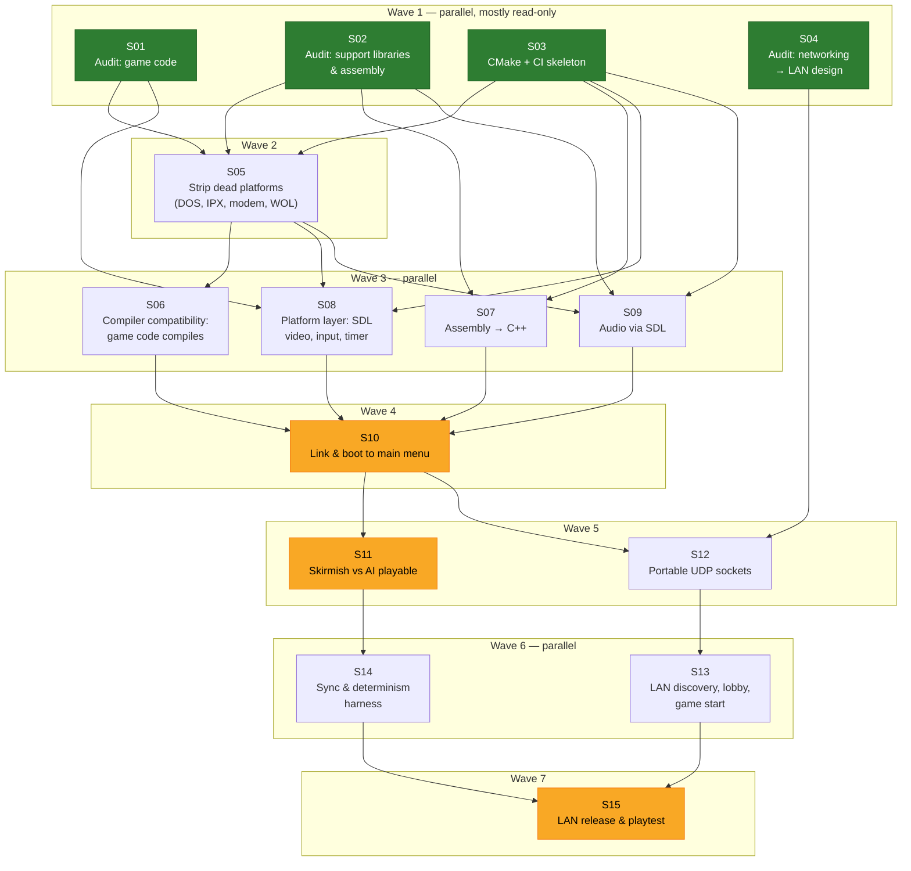

# Roadmap — Visual Plan

This page is the visual plan for the first three milestones (M1 boots → M2 plays → M3 LAN with friends).
Each box is a **session**: a unit of work that fits in one sitting and ships as one PR.
Details for each session are in [`sessions/`](sessions/README.md).

## Phases at a glance

```mermaid
flowchart LR
    P0["Phase 0<br/>Foundation<br/>(wiki & plan)"]:::done --> P1["Phase 1<br/>Understand & strip<br/>S01–S05"]
    P1 --> P2["Phase 2<br/>Make it build<br/>S06–S09"]
    P2 --> M1(["M1<br/>It boots"]):::milestone
    M1 --> P3["Phase 3<br/>Make it play<br/>S10–S11"]
    P3 --> M2(["M2<br/>It plays"]):::milestone
    M2 --> P4["Phase 4<br/>LAN multiplayer<br/>S12–S15"]
    P4 --> M3(["M3<br/>LAN with friends"]):::milestone
    M3 -.-> Later["Later: internet play,<br/>lobby server, matchmaking, ranked"]:::later

    classDef done fill:#2e7d32,color:#fff,stroke:#1b5e20
    classDef milestone fill:#f9a825,color:#000,stroke:#f57f17
    classDef later fill:#eeeeee,color:#555,stroke:#999,stroke-dasharray: 4 3
```

## Session dependency graph

An arrow means "must finish before". Sessions in the same **wave** don't depend on each other,
so separate agents can work on them in parallel.

Green sessions are done. Highlighted sessions end in a milestone: **S10 → M1**, **S11 → M2**, **S15 → M3**.

## Waves and how many agents can work at once

| Wave | Sessions | Parallel agents | Exit condition |
|------|----------|-----------------|----------------|
| 1 | S01, S02, S03, S04 | 4 | Audits written in `docs/codebase/`; CI builds an empty target |
| 2 | S05 | 1 | Dead code removed, decisions recorded |
| 3 | S06, S07, S08, S09 | 4+ (S06 and S07 split further by file group) | Every kept source file compiles |
| 4 | S10 | 1–2 | **M1**: main menu on screen |
| 5 | S11, S12 | 2 | **M2**: skirmish playable; UDP layer portable |
| 6 | S13, S14 | 2 | Two instances play over localhost with sync checks |
| 7 | S15 | 1 + friends | **M3**: LAN games with friends |

## Biggest risks

| Risk | Why it matters | What we do about it |
|------|----------------|--------------------|
| The code assumes 32-bit (`long` = 32 bits, pointer ↔ int casts, `#pragma pack(1)` network structs) | Silent bugs and desyncs on 64-bit | Build 32-bit x86 first (ADR-0003). Go 64-bit later, as its own session. |
| ~340 assembly files in the libraries | No modern assembler accepts TASM/Watcom syntax | S02 finds which ones the Win32 build actually links. S07 ports only those. |
| Determinism breaks during porting | LAN games desync | S14 builds a sync harness. Anything that touches the simulation is flagged in logs. |
| Windows-message-driven sockets (`WSAAsyncSelect`) | Don't work without a Win32 window loop and aren't portable | S12 replaces them with polled non-blocking sockets. |
| Missing proprietary libraries (HMI SOS, Greenleaf) | Code won't link | Greenleaf is modem/DOS only, so it gets deleted (S05). Audio is replaced via SDL (S09). |
